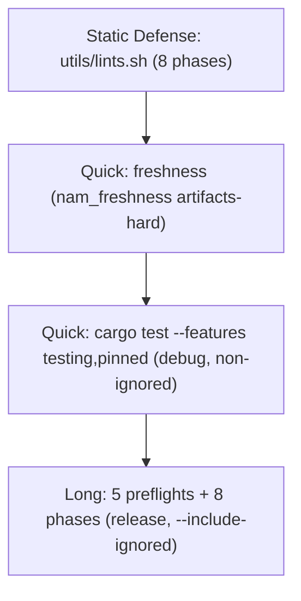

<!--
SPDX-License-Identifier: Apache-2.0
Copyright (c) 2026 Fábio Henrique de Lima Silva (fhl.bsb@gmail.com) All rights reserved.
-->

# Test Architecture

This document defines the organization, execution tiers, and validation principles of the test and static defense suite for `NeuralAmpModeler-rs`. The executable code (`tests/`, `src/**/*_test.rs`) and typed receipts are the primary source of truth.

> [!NOTE]
> **Document Scope & Hierarchy:**
>
> - **Static Analysis & Quality Defense:** Static validation across all feature axes, Clippy, doc-tests, and policy checks via [utils/lints.sh](../utils/lints.sh) (§2).
> - **Functional & Correctness Architecture:** Automated test architecture, feature gating, execution phases, and oracle validation via [utils/tests-quick.sh](../utils/tests-quick.sh) and [utils/tests-long.sh](../utils/tests-long.sh) (§3–§6).
> - **Manual Testing & Human Release Certification:** Step-by-step developer functional verification (Tiers 1–3) and the 5-receipt human release certification protocol reside in [functional-tests.md](functional-tests.md).
> - **Performance Regression Gates:** The statistical Criterion benchmarking wall and baseline governance reside in [benchmarks.md](benchmarks.md).
> - **Fixtures & Golden Vectors:** Ground-truth vector generation, model resolution order, and hash manifests reside in [fixtures.md](fixtures.md).
> - **Acoustic & Perceptual Validation:** Metric formulations (ESR, SNR, MR-STFT, THD+N) and perceptual calibration thresholds reside in [perceptual_validation.md](perceptual_validation.md).

---

## 1. Crate Features Taxonomy

The `NeuralAmpModeler-rs` crate defines several features in [Cargo.toml](../Cargo.toml) to configure runtime targets, test capabilities, and diagnostic facilities:

| Feature Name             | Default | Description                             | Active Scope & Modules                                                                                                                                         |
|:------------------------ |:-------:|:--------------------------------------- |:-------------------------------------------------------------------------------------------------------------------------------------------------------------- |
| **`dual-mono`**          | Yes     | Independent dual-mono inference         | [src/dsp/pipeline/stages/input.rs](../src/dsp/pipeline/stages/input.rs) (dual-mono DSP variants)                                                               |
| **`testing`**            | No      | Test utilities, signals & generators    | [src/testing/](../src/testing/), CLI binaries (`nam_golden_catalog`, `nam_freshness`, `nam_long_receipt`, etc.)                                                |
| **`heap-audit`**         | No      | Memory allocation interceptor           | [src/common/alloc_audit.rs](../src/common/alloc_audit.rs), [tests/rt_constraints/](../tests/rt_constraints/) heap checks                                       |
| **`pinned`**             | No      | Harness for pinned long-test targets    | [tests/rt_pinned.rs](../tests/rt_pinned.rs), [tests/soak_pinned.rs](../tests/soak_pinned.rs); enabled only by `utils/tests-long.sh` and `utils/tests-quick.sh` |
| **`fft-radix4-planner`** | No      | Radix-4 FFT benchmark planner           | [benches/fft_radix4_bench.rs](../benches/fft_radix4_bench.rs) (Radix-4 DIT FFT planning routines)                                                              |
| **`avx512`**             | No      | Research/measurement AVX-512 kernels    | [src/math/activations/](../src/math/activations/), SIMD dispatch tables                                                                                        |
| **`rt-hardening`**       | No      | Real-time OS host tuning (Linux, macOS) | [src/rt_hardening/](../src/rt_hardening/) (Linux: THP, mlockall, SCHED_FIFO, DAZ/FTZ, IRQ affinity; macOS: QoS, time constraint, mlock_region, workgroups)     |
| **`on-demand`**          | No      | Internal developer diagnostics          | Internal-only fixture generation and profiling harnesses (never enabled by CI or published test instructions)                                                  |

---

## 2. Static Analysis & Quality Defense (`utils/lints.sh`)

[`utils/lints.sh`](../utils/lints.sh) is the **static first line of defense** of the project. It runs quickly (~45 seconds) and acts as an uncompromising quality gate that developers should execute regularly during active coding, before staging any commit, and as Receipt #1 in formal release certification.

Unlike test runners, `lints.sh` does not evaluate numerical audio outputs. Instead, it statically proves compilation cleanliness, zero-warning compliance, documentation hygiene, and policy conformance across the entire feature matrix.

### 2.1 The Eight Sequential Verification Phases

1. **Formatting:** Runs `cargo fmt --all`, or `cargo fmt --all -- --check` when `CI=true`.
2. **Compilation:** Runs `cargo check --locked --workspace --all-targets` with four configurations: defaults; `--no-default-features`; `--all-features`; and `--no-default-features --features testing,heap-audit,fft-radix4-planner,rt-hardening`.
3. **Clippy:** Runs the same four configurations with `-D warnings`.
4. **Cross-target Clippy:** Requires the opposite Linux architecture target (`aarch64-unknown-linux-gnu` on `x86_64` hosts; `x86_64-unknown-linux-gnu` on `aarch64` hosts) plus the Windows targets (`x86_64-pc-windows-msvc` and `aarch64-pc-windows-msvc`), running `cargo clippy --locked --lib --target <cross_target> -- -D warnings`. When a cross target is not installed, that phase records a typed `GAP` (`clippy-<target>:target-not-installed`) instead of `PASS`.
5. **Documentation:** Runs `cargo doc --locked --no-deps --all-features` with rustdoc warnings denied. Doc-tests belong to the test runner, not this phase.
6. **SPDX:** Checks all tracked `.rs`, `.sh`, `.py`, `build.rs`, and `Cargo.toml` files (`git ls-files`) for an accepted SPDX identifier. Enumeration failures, an empty enumeration, and `grep` errors fail the phase; only files that were inspected and lack the identifier are reported as missing.
7. **Policies:** Checks `tests/common/`, lint-suppression comments, `doc(cfg)` features, and README version and MSRV.
8. **Script budget:** Checks declared line budgets for shell scripts in `utils/` and `tests/fixtures/`.

`utils/_lib.sh` is pure when sourced: it defines variables and helpers only and never changes the caller's working directory. Creating `target/logs`, resetting `summary.txt` for a new pre-exported `NAM_RUN_ID` (a locally generated id only accumulates and prints a `RUN: <id>` marker line), and removing the discipline's stale `*-status.tsv` carrier happen exclusively in `lib_init`, which every Class A script (`lints.sh`, `tests-quick.sh`, `tests-long.sh`, `quality-dashboard.sh`) calls after parsing `-h/--help` and validating arguments via `usage_fail`. Consequently `./utils/<script>.sh --help` or an invalid flag never creates directories or destroys previous evidence.

### 2.2 Developer Usage & Flags

```bash
# Standard interactive execution
./utils/lints.sh
```

### 2.3 docs.rs Parity Check (Opt-in, Nightly)

The crate page published by docs.rs is rendered by **nightly** rustdoc with `--cfg docsrs`. Documentation diagnostics that only nightly reports — broken intra-doc links, redundant explicit link targets, and missing `doc(cfg(feature = "..."))` seals — are invisible to the stable `lints.sh` gate (§2.1, phase 5). [utils/docsrs-check.sh](../utils/docsrs-check.sh) mirrors the docs.rs configuration to catch those regressions before publishing.

```bash
# Opt-in: requires an isolated nightly toolchain (never part of the stable gates)
./utils/docsrs-check.sh
```

The script exports `DOCS_RS=1` and `RUSTDOCFLAGS="--cfg docsrs -D warnings"`, derives the feature scope and all target triples from `package.metadata.docs.rs` in [Cargo.toml](../Cargo.toml) (`x86_64-unknown-linux-gnu`, `x86_64-pc-windows-msvc`, `aarch64-apple-darwin`, `aarch64-unknown-linux-gnu`, `aarch64-pc-windows-msvc`), and runs `cargo +nightly doc --locked --lib --no-deps --target <target>` (`--lib` mirrors the docs.rs build) for every installed nightly target. Missing nightly targets record a typed `GAP` (`docsrs-<target>:target-not-installed`) and yield `RESULT: PASS_WITH_GAPS` (exit `0`) rather than failing silently or overclaiming coverage. Note that `cargo clippy` (`lints.sh`) does **not** invoke `rustdoc`, and the native `macos-latest` and `windows` CI jobs do not currently run `cargo doc` (Linux `lints.sh` runs host `cargo doc` only), so targets absent from the local nightly toolchain remain unverified until tested on native rustdoc or checked post-publish on `docs.rs`. The `nam_avx512` cfg is emitted by `build.rs` only for x86_64 targets, so the AVX-512 modules are absent from the aarch64 pass. Exit `0` means zero rustdoc warnings on all executed targets (`PASS` when all 5 targets are installed, `PASS_WITH_GAPS` when any target is missing); exit `2` is returned when `rustup` or the nightly toolchain is unavailable; any rustdoc warning fails with exit `1`.

### 2.4 SemVer Baseline Check (Opt-in, Pre-release)

The published SemVer baseline is the **last release available on crates.io** (`0.8.0`), not the local `Cargo.toml` version. Before publishing, compare the current API surface against that baseline with [`cargo-semver-checks`](https://github.com/obi1kenobi/cargo-semver-checks):

```bash
# Release gate: the local version (2.0.0) is a major bump, so every intended
# break is already covered; a clean surface prints "no semver update required".
cargo semver-checks check-release --baseline-rev v0.8.0

# Enumeration aid (evidence only): force a non-major release type to list every
# breaking change relative to 0.8.0, so each one can be marked as intentional.
cargo semver-checks check-release --baseline-rev v0.8.0 --release-type minor
```

`--baseline-rev` resolves the baseline from the local `vX.Y.Z` git tag, avoiding a crates.io round-trip; `--baseline-version 0.8.0` is the registry equivalent. The tool requires an isolated nightly rustdoc toolchain and is an **opt-in, out-of-band** check: it is never part of the stable `utils/lints.sh` gate. Exit `0` from the release-gate form means the declared version bump covers every detected change. The `--release-type` form only selects which checks run; its exit code still reflects the declared version delta, so read the printed `Summary` line (not the exit code) when enumerating breaks. Reports are archived as PR/packaging evidence and are not committed as tool artifacts.

---

## 3. Test Execution Phase Architecture — Two-Axis Model

Test selection and execution are governed by **two orthogonal axes**:

- **Axis A — Rigor (`#[ignore]`):**
  - *Non-ignored:* First line of defense for daily local iteration. Fast, deterministic.
  - *`#[ignore]`*: Exhaustive audits, numerical soak, full proptest sweeps, and long parity matrices executed in nightly or pre-release runs.
- **Axis B — Codegen Path (Debug vs. `--release`):**
  - *Debug (`cargo test`):* Structural tests (logic, parsers, FSM transitions, bitwise determinism) execute with `debug-assertions` active. Float codegen optimizations are irrelevant here.
  - *Release (`cargo test --release`):* Measurement oracles (evaluating floating-point outputs against reference models) must execute under release optimization (`-O3`, FMA contraction, vectorization). Measuring floats in debug checks an unoptimized codegen path that does not reflect production runtime behavior.



### 3.1 Quick QA Suite (`utils/tests-quick.sh`)

The quick suite executes in ~16–102 seconds (measured: 16–22 s with a warm incremental cache, 64–102 s cold/nightly; budget ≤ 5 minutes) and runs two sequential phases:

1. **Freshness (`nam_freshness artifacts-hard`):**
   - **Scope:** Verifies golden artifact freshness and integrity via [tools/qa/src/bin/nam_freshness.rs](../tools/qa/src/bin/nam_freshness.rs). Exit code 3 is recorded solely as the `generator-drift` gap (never paired with `PASS` on the same phase); exit code 0 passes; other nonzero exit codes fail the phase. Generator drift is informational in this mode: the quick suite reports the gap and does not block (`artifacts-hard`), whereas the long `preflight-freshness` gate runs `hard-fail` (below).
2. **Tests (`cargo test --locked --features testing,pinned --no-fail-fast`):**
   - **Scope:** Runs every non-ignored test target in the **debug** profile with the `testing` and `pinned` features (measured: 2,273 passed on `x86_64` Linux, 2,240 passed on `aarch64` Linux including 12 NEON-specific intrinsic/register tests, 2,216 passed on `aarch64` macOS Apple Silicon where Linux-specific `memfd`/sysfs tests are gated, 2,254–2,255 passed on `x86_64-pc-windows-msvc`, and 2,265 passed on `aarch64-pc-windows-msvc`; 310–311 ignored across platforms; enforced minimum floor `assert_ran_tests` ≥ 2,000). This includes structural/logic/parser/FSM tests, non-ignored numerical and parity checks, the four non-ignored RT/soak tests from the pinned targets, and the `libm_export_guard` ELF symbol gate. Float oracles here are smoke checks only; release-profile measurements belong to the long suite.
   - **Exclusions:** `#[ignore]` tests (soak, RT deadline/jitter, exhaustive audits, and the ignored proptest sweeps) are not invoked by the quick suite.

**Logs and gaps:** the phases write `target/logs/quick-freshness.log` and `target/logs/quick-tests.log`; tests that skip an unavailable capability (C++ oracle, fixtures, non-distributable or community models) append a typed record to `target/logs/skips-<NAM_RUN_ID>.jsonl` (falling back to `target/logs/skips.jsonl` only when no run id is exported). After the test phase, `nam_skips` parses that skip log fail-closed: legitimate absence counts as `0` skips, `"optional":true` entries are non-blocking, non-optional valid records emit `skip-capability:<n>` (`PASS_WITH_GAPS`), and an unreadable file, directory, dangling symlink, malformed JSONL line, invalid required field, or `run_id` mismatch fails the `skips` phase (`FAIL`, log in `target/logs/quick-skips.log`). Skip evidence is never deleted by the quick suite, so two runs with distinct run ids cannot mix their blocking counts. The quick suite never emits a receipt; it ends with the canonical `RESULT:` line. Every failure path (freshness, tests/compilation, zero tests executed, invalid skip evidence, or an unexpected error) emits the phase `FAIL`, exactly one `RESULT: FAIL`, and the current `target/logs/tests-quick-status.tsv` carrier. The stale carrier is removed at the start of the run, and a carrier write failure is itself reported as a failure instead of preserving an earlier verdict. `utils/tests-long.sh --strict` (which exports `NAM_REQUIRE_CPP_ORACLE=1`) is the fail-closed counterpart for a missing C++ oracle.

### 3.2 Golden Vector Supply Chain & Freshness

Golden vectors validate inference determinism against pre-rendered reference outputs:

- **Freshness Manifest:** [tests/fixtures/golden_gen_build.sh](../tests/fixtures/golden_gen_build.sh) maintains the versioned `.golden_manifest.sha256` digest manifest. The quick `freshness` phase and the long `preflight-freshness` gate verify this integrity using `src/testing/freshness.rs` (`nam_freshness`). Any model modification without golden regeneration triggers a hard failure.
- **Model Resolution Order:** Models are resolved hierarchically: (1) `$NAM_MODELS_DIR`, (2) `third-party/community_models/`, (3) `tests/fixtures/models-nondist/`, (4) `tests/fixtures/models/`. Details are documented in [fixtures.md](fixtures.md).

### 3.3 Binary Defense & Compile-Time Segregation

- **Libm Export Guard:** [tests/libm_export_guard.rs](../tests/libm_export_guard.rs) is a fail-closed ELF symbol gate executed on the linked binary artifact in the `tests-quick.sh` tests phase and the `tests-long.sh` `catch-all` phase. It ensures internal `libm` mathematical symbols are hidden and cannot interpose over system C library symbols. `nm`/`llvm-nm` always run with `LC_ALL=C`/`LANG=C` in the child process, so localized messages never change the verdict. The dynamic table (`nm -D`) is the canonical surface for interposition and must contain a `__libc_start_main` import as proof that `.dynsym` was read; the static table is scanned only when present (a stripped release binary legitimately has none). Missing tools, a failing `nm`, or an absent dynamic witness fail closed.
- **AVX-512 Segregation Contract:** AVX-512 code is strictly segregated at compile time via `#[cfg(feature = "avx512")]`. Default builds monomorphize only `Avx2Math`. The evidence for the absence of EVEX/ZMM code in default release artifacts is a compile-time guarantee (the AVX-512 modules are not compiled without the feature), not binary inspection of `.text`. Runtime hardware capabilities and effective dispatch status are inspected using [`src/bin/simd_probe.rs`](../src/bin/simd_probe.rs) (`cargo run --quiet --bin simd_probe`). Contractual compliance is enforced at compile time and runtime by `tests/isa_contract.rs` (`contract_default_build_never_dispatches_avx512`). **GAP `binary_inspection_evex_zmm_absent`:** no fail-closed `.text` inspection (`nm`/`objdump`) runs on the default release artifact; the historical tool (`utils/verify_no_avx512_release.sh`) was retired in commit `75b0f50ff0`. Closing this gap requires a new fail-closed scanner, which is not part of the current contract.

### 3.4 Continuous Integration Workflow (`.github/workflows/ci.yml`)

Every push and pull request targeting `main`, `dev` or `dev-*` triggers the multi-platform CI matrix:

1. **`x86_64-linux` (`ubuntu-26.04`):** Installs `aarch64-unknown-linux-gnu`, `x86_64-pc-windows-msvc`, and `aarch64-pc-windows-msvc` for the cross-target Clippy gates, records `target/logs/ci-provenance.log`, and executes `./utils/lints.sh` (with `CI=true`). This job is intentionally lint-only so a documentation/policy failure cannot suppress functional evidence.
2. **`x86_64-linux-quick` (`ubuntu-26.04`):** Records `target/logs/ci-provenance.log`, runs `./utils/tests-quick.sh` (2,273 passed, 311 ignored), compiles `nam_parity_vector` in release mode, and generates release parity vectors for canonical reference models. It is independent of the lints job; `cross-platform-parity` waits for this job.
3. **`aarch64` matrix (`macos-latest` Apple Silicon and `ubuntu-26.04-arm`):** `ubuntu-26.04-arm` installs `x86_64-unknown-linux-gnu`, `x86_64-pc-windows-msvc`, and `aarch64-pc-windows-msvc` for the full cross-target Clippy gate and runs the full canonical `./utils/lints.sh` discipline before `./utils/tests-quick.sh` (2,240 passed, 307 ignored); `macos-latest` runs `cargo clippy` plus `./utils/tests-quick.sh` (2,216 passed, 307 ignored) because the full lint matrix exceeds its job budget. Both record `target/logs/ci-provenance.log`, compile `nam_parity_vector` in release mode, and generate release parity vectors on native ARM hardware; logs under `target/logs/**` are published as artifacts.
4. **`msrv` (`ubuntu-26.04`):** Resolves `rust-version` from `Cargo.toml` (1.99.0), records `target/logs/ci-provenance.log`, and verifies `cargo check --locked --workspace --all-targets --features testing` on the exact MSRV toolchain (exporting `RUSTUP_TOOLCHAIN: 1.99.0` to override the repository's `rust-toolchain.toml`). The step enables `pipefail`, preserves the real `cargo`/`tee` exit status, and publishes `target/logs/msrv.log`, `summary.txt`, `msrv-status.tsv`, and `ci-provenance.log` as a diagnostic artifact even on failure; a `cargo check` or log-write failure fails the job.
5. **`cpp-parity` (`ubuntu-26.04`):** Provisions the upstream C++ reference mirror (`lib_quiet=1 ./utils/setup-third-party.sh`), compiles the C++ `namcore_render` binary (`lib_quiet=1 ./utils/ensure_namcore_render.sh`), and executes `NAM_REQUIRE_CPP_ORACLE=1 ./utils/tests-quick.sh` (2,273 passed, 0 gaps). Provisioning helpers run under `lib_quiet=1` so `summary.txt` records only the `tests-quick.sh` discipline. This job is independent of the lints job and exercises only the non-ignored C++ oracle cases of the quick discipline: the 12 multichannel-linear and 3 WAV-IR tests in [tests/parity/cpp_parity.rs](../tests/parity/cpp_parity.rs). The extensive `quick_parity_*`, `live_cross_validation_*`, sequential and cabsim matrices remain `#[ignore]` and run only in the long discipline. The job fails closed if the oracle is unavailable; it is not a certificate of full C++ parity coverage.
6. **`consumer-smoke` (`ubuntu-26.04` and `ubuntu-26.04-arm`):** Installs Linux, macOS, and Windows cross targets (`x86_64-unknown-linux-gnu`, `aarch64-unknown-linux-gnu`, `aarch64-apple-darwin`, `x86_64-pc-windows-msvc`, `aarch64-pc-windows-msvc`), records `target/logs/ci-provenance.log`, and executes `./utils/consumer-smoke.sh` to validate the external-consumer contract; the x86 rejection is decided by the structured `nam-contract.txt` artifact, not by build-log text.
7. **`windows` matrix (`windows-x64` on `windows-2025` and `windows-arm64` on `windows-11-arm`):** Runs under Git for Windows `bash` with `CARGO_INCREMENTAL=0`, `RUSTDOCFLAGS="-D warnings"`, and `Swatinem/rust-cache` (`cache-all-crates: false`, `save-if` restricted to `main` and `dev`). Records provenance (`ImageOS`, `ImageVersion`, `cmd //c ver`), executes `nam_preflight` in safe baseline (`env -u RUSTFLAGS`; emits a typed `cpu-missing-x86-64-v3` `GAP` and skips `v3` binaries if exit code `3`), runs native MSVC `cargo clippy --locked --workspace --all-targets --features testing -- -D warnings`, executes `./utils/tests-quick.sh` (2,254 passed on `windows-2025`, 2,265 passed on `windows-11-arm`), and exports release parity vectors (`retention-days: 7`) plus logs (`retention-days: 7`).
8. **`cross-platform-parity` (`ubuntu-26.04`, `needs: [x86_64-linux-quick, aarch64, windows]`):** Downloads parity vector artifacts generated in the release profile across the native runners (`x86_64-linux`, `linux-arm64`, `macos-arm64`, `windows-x64`, and `windows-arm64`) for the exact same commit and run attempt (`NAM_RUN_ID`). Executes pairwise comparisons via `nam_parity_vector compare`: strict bitwise identity (`0 ULP`) for intra-ISA runs (`linux-arm64` vs `macos-arm64`, `linux-arm64` vs `windows-arm64`, `macos-arm64` vs `windows-arm64`, and `x86_64-linux` vs `windows-x64` when `WIN_V3_READY=1`), and calibrated numerical contract validation (`--max-esr 1e-6 --min-snr-db 100.0`, zero NaNs, zero subnormals) for cross-ISA runs (`x86_64` vs `aarch64`). Missing runner data triggers a fail-closed `GAP` or failure. AVX-512 opt-in execution status is formally declared as `GAP` due to the absence of physical AVX-512 hardware on standard CI runners.

### 3.5 Cross-Platform Parity Vector Protocol (`NAMPARV1` & `nam_parity_vector`)

To ensure bit-level determinism and numerical parity across differing CPU architectures (x86-64-v3, aarch64 NEON, and Apple Silicon), NeuralAmpModeler-rs establishes a binary parity vector protocol:

- **Binary Specification:** Vectors begin with the 8-byte magic `NAMPARV1` followed by a 32-bit LE version, length-prefixed JSON provenance header, 32-byte SHA-256 payload checksum, and contiguous IEEE-754 `f32` samples in Little-Endian format.

- **Bitwise Precision:** Parity evaluation compares raw IEEE-754 bit representations (`f32::to_bits()`). Signed zeros (`+0.0` vs `-0.0`) have different bit encodings (`0x00000000` vs `0x80000000`) and are strictly flagged as mismatches.

- **FP Anomaly Policy:** NaNs and subnormals are never normalized or flushed silently during vector export or comparison; raw bit patterns are preserved and reported.

- **Compatibility Invariants:** Mismatches in sample rate, block quantum, model SHA-256, signal SHA-256, channels, or initial state are treated as incompatible vectors and rejected with exit code 2.

- **CLI Utility (`tools/qa/src/bin/nam_parity_vector.rs`):**

  ```bash
  # Generate release inference parity vector:
  cargo run --release -p nam-qa --bin nam_parity_vector -- generate \
    --model tests/fixtures/models/BossWN-standard.nam \
    --signal v1 --out target/parity-vectors/host.bin

  # Compare two vectors bit-by-bit:
  cargo run --release -p nam-qa --bin nam_parity_vector -- compare \
    target/parity-vectors/ref.bin target/parity-vectors/test.bin

  # Inspect metadata and signal statistics:
  cargo run --release -p nam-qa --bin nam_parity_vector -- inspect target/parity-vectors/host.bin
  ```

### 3.6 Hardware Classification Taxonomy & Baseline Comparability

To ensure that latency regression benchmarks and performance baselines are anchored in real, comparable physical hardware environments (preventing the Ryzen 7 5700U baseline from being erroneously applied across differing architectures), the engine establishes a typed `HardwareClass` taxonomy ([`src/testing/qa/env.rs`](../src/testing/qa/env.rs)):

| Hardware Class Identifier | Target Platform & Architecture    | Description                                                                   |
|:------------------------- |:--------------------------------- |:----------------------------------------------------------------------------- |
| `x86_zen3_laptop`         | Linux x86-64-v3 (Ryzen 7 5700U)   | Reference development host baseline recorded in `docs/quality-contract.json`. |
| `x86_amd_zen`             | Linux x86-64-v3 (Zen 2/3/4/5)     | AMD desktop/server workstation host class.                                    |
| `x86_intel_client`        | Linux x86-64-v3 (Core i-series)   | Intel client architecture with AVX2/FMA/F16C/BMI2.                            |
| `x86_avx512_server`       | Linux x86-64 (Xeon/EPYC Genoa)    | Server-grade host with full AVX-512 Foundation and Vector Length extensions.  |
| `x86_generic_v3`          | Linux x86-64-v3                   | Generic compliant x86-64 microarchitecture.                                   |
| `aarch64_apple_silicon`   | macOS ARM64 (M-series)            | Apple Silicon M1/M2/M3/M4 with ARM64 NEON SIMD.                               |
| `aarch64_linux_server`    | Linux AArch64 (Graviton/Neoverse) | Cloud server ARM64 architecture (e.g. AWS Graviton 3/4).                      |
| `aarch64_generic`         | Linux AArch64                     | Standard AArch64 Linux host with NEON.                                        |
| `unknown`                 | Unclassified / VM / Windows       | Unverified or non-reference host (fails closed; all `windows` host triples deterministically map here). |

**Comparability Invariant:** Both the performance gate ([`src/bin/nam_perf_gate.rs`](../src/bin/nam_perf_gate.rs)) and the contract verification engine ([`src/testing/qa/verify.rs`](../src/testing/qa/verify.rs)) enforce strict hardware class matching. When a benchmark run or verify report belongs to a different hardware class than the baseline provenance, the performance domain evaluates to `NOT_VERIFIED` (`PerformanceVerdict::NotVerified` / `RegressionOutcome::NotVerified`), preventing false performance rejections or unverified passes.

### 3.7 Continuous Perceptual Metrics vs. Strict Bitwise Parity

The engine clearly delineates between continuous numerical metrics and raw bitwise determinism:

- **Perceptual Error Metrics (ESR, SNR, MSE, MR-STFT):** Continuous metrics used to quantify fidelity against analog reference signals or floating-point models. Cross-ISA budgets (e.g. `WN_ESR_BUDGET: 1e-3`, `LSTM_ESR_BUDGET: 1e-2`, `A2_ESR_BUDGET: 1e-3` in `tests/parity/isa_parity.rs`) are conservative regression safety nets designed to prevent numerical drift in recurrent loops or transcendental approximations.
- **Strict Bitwise Parity (`f32::to_bits()`):** Ground-truth cross-runner evaluation performed by `nam_parity_vector compare` and `compare_samples_bitwise`. Requires exact IEEE-754 bit-pattern equality (`mismatch_count == 0` over all $N$ processed samples). Signed zeros (`+0.0` vs `-0.0`) and non-canonical subnormals are flagged as distinct bit mismatches.

### 3.8 Container Oracle Provenance & Explicit Historical Gaps

- **Container f64 Provenance:** Container families have no independent f64 reference in the oracle. `src/testing/qa/ids.rs` classifies them as substitutes, and `nam_quality ingest` records `f64_oracle_provenance: "proxy:<fixture>"` in the ledger for every such join (including `Container A2-Full`, `Container A2-Lite`, `Container File …` and `SlimmableContainer A2 Example (CH=3→6)`). The dashboard marks the corresponding f64 ESR with `*`. The `SlimmableContainer A2 Example (CH=3→6)` label is evaluated against `wavenet_a2_lite.nam` (identical baseline `1.82e-14`) because the golden catalog's `a2_example.nam` (CH=8) is an uncatalogued container fixture that the f64 oracle phase does not measure independently. A proxy value is never a f64 measurement of the container.
- **Matriz v2 §3.3 Explicit GAP:** The historical "matriz v2 §3.3" referenced in legacy notes is formally documented as an explicit gap (`GAP`). The original matrix document is absent from the repository; in accordance with fail-closed governance, no maturity claims are inferred from missing artifacts.

### 3.9 Operational Roles & Separation of Concerns

To guarantee measurement integrity and host stability:

- **Automated AI Assistant Role:** Limited to static analysis (`utils/lints.sh`), fast unit and regression verification (`utils/tests-quick.sh`, maximum one run per task), and non-mutating quality checks (`utils/quality-dashboard.sh --check docs/quality-contract.json`). All resource-intensive compilation tasks must run under cgroup memory protection.
- **Human Operator Role:** Exclusive responsibility for long-running audit suites (`utils/tests-long.sh`), nightly ceremonies, baseline recording (`--save`), and physical latency benchmarks on calibrated, unconstrained bare-metal hardware without cgroups, CPU throttling, or concurrent builds.

### 3.10 Windows 11 Experimental Validation, Explicit Gaps & Community Audit Protocol

Windows 11 (`x86_64-pc-windows-msvc` with `x86-64-v3` and `aarch64-pc-windows-msvc` with `NEON` + ARMv8.1 LSE) is validated under a three-layer **Experimental Verifiable** pipeline:

- **Layer 0 (Cross-target Static & Consumer Gates):** `utils/lints.sh` runs `clippy-win-x64` and `clippy-win-arm64`, and `utils/consumer-smoke.sh` verifies external-consumer builds for both Windows MSVC triples.
- **Layer 1 (Native Preflight, Quick Suite & Heap Audit):** `nam_preflight` verifies OS version, SIMD baseline, `VirtualAlloc2` + `MapViewOfFile3` mirroring, and ARMv8.1 LSE / `QPC` fallback; `utils/tests-quick.sh` executes under Git for Windows `bash` (`2,255 passed, 0 failed` on physical Windows 11 Pro 26H2; `2,254 passed` on CI `windows-2025`; `2,265 passed` on CI `windows-11-arm`); `rt_constraints` (`--features testing,heap-audit`) verifies `12/12` zero-allocation hot-path invariants.
- **Layer 2 (Cross-Platform Bitwise Parity):** `nam_parity_vector compare` confirms `0 ULP` bitwise identity (`bitwise_identical = true`, `ESR = 0.0`) across all 7 canonical models between Linux `x86_64`, Windows `x64`, Windows `ARM64`, Linux `ARM64`, and macOS `ARM64`.

**Explicit Gaps (5):**

1. **No MSVC C++ Oracle (`namcore_render`):** `cpp_parity.rs` records `skip-capability:15` on Windows because `ensure_namcore_render.sh` targets POSIX/CMake toolchains.
2. **No `rt-hardening` on Windows:** `rt-hardening` is compiled only for Linux and macOS (`cfg(any(target_os = "linux", target_os = "macos"))`); `mlock`, `SCHED_FIFO`, and MMCSS are absent.
3. **No `tests-long.sh` or Calibrated RT Baseline:** Windows hosts return `HardwareClass::Unknown` (§3.6), preventing Linux bare-metal latency thresholds from being misapplied.
4. **Hosted VM ARM64 Validation:** `aarch64-pc-windows-msvc` is validated on `windows-11-arm` CI runners (`Cobalt 100`) without local physical ARM64 hardware.
5. **No Audio Host / Driver Integration:** WASAPI/ASIO integration is outside the scope of the core DSP crate. Additionally, `utils/docsrs-check.sh` checks all five `package.metadata.docs.rs` targets whenever their nightly targets are installed and emits a typed `GAP` for absent targets (such as Windows MSVC nightly targets on Linux); `cargo clippy` does not invoke `rustdoc`, and native Windows CI does not currently run `cargo doc`, so Windows `docs.rs` rendering remains an explicit `GAP` until validated on native Windows rustdoc or post-publish on `docs.rs`.

**Community Reproduction Protocol (Windows 11, from a repository checkout, Git Bash):**

```bash
# 1. Preflight hardware & OS capability check (safe baseline)
cargo run --locked -p nam-preflight --bin nam_preflight

# 2. Quick QA suite (requires Git for Windows bash >= 4 and LF checkout)
./utils/tests-quick.sh

# 3. Zero-allocation RT heap audit
cargo test --locked --test rt_constraints --features testing,heap-audit

# 4. Generate release parity vector for cross-platform comparison
cargo run --locked --release -p nam-qa --bin nam_parity_vector -- generate --model tests/fixtures/models/BossWN-standard.nam --out target/parity.bin
```

All `DiagnosticBundle` exports and crash logs automatically redact `USERPROFILE`, `LOCALAPPDATA`, `C:\...` drive paths, and UNC paths before persisting or reporting diagnostics.

---

## 4. Test Placement Rules

Test location is strictly governed by scope and size:

| Axis                                                          | Rule                                 | Execution Target                                                                       |
|:------------------------------------------------------------- |:------------------------------------ |:-------------------------------------------------------------------------------------- |
| Structural / logic / parsers / FSM / bitwise                  | Non-ignored, **Debug**               | `tests-quick.sh` tests phase (all non-ignored targets)                                 |
| Non-ignored numerical / parity checks                         | Non-ignored, **Debug** (quick smoke) | `tests-quick.sh` tests phase; release-grade measurement in `tests-long.sh` `catch-all` |
| Exhaustive matrix / soak / heap-audit / RT / Loom model check | `#[ignore]` or feature-gated         | `tests-long.sh` `catch-all`, `soak`, `heap-audit`, `rt-deadline`, `rt-jitter`, `loom`  |
| Performance regression gate                                   | Contract-driven benchmark check      | `tests-long.sh` `perf` (and the standalone `nam_perf_gate`)                            |

Any test marked `#[ignore]` without an invocation in `tests-long.sh` or an explicit on-demand reason comment (`// on-demand:`) is considered an orphan.

### 4.1 Unit Test Placement & The 300-Line Rule

Unit tests adhere to strict source organization rules:

- **Files < 300 source lines:** Tests are declared inline within an embedded module:

  ```rust
  #[cfg(test)]
  mod tests {
      use super::*;
      // ...
  }
  ```

- **Files ≥ 300 source lines:** Tests are extracted to a dedicated sibling file `<module>_test.rs` and included via:

  ```rust
  #[cfg(test)]
  #[path = "<module>_test.rs"]
  mod tests;
  ```

- **Off-RT Boundary:** Test utilities, golden generators, and off-RT validation helpers reside in `src/testing/` — never in `src/dsp/` or hot-path audio processing modules.

### 4.2 Modular Integration Entry Points

Integration tests are partitioned into cohesive entry points under `tests/`:

- [tests/models.rs](../tests/models.rs): Model instantiation, architecture validation, and golden vector comparisons.
- [tests/parity.rs](../tests/parity.rs): Reference oracle comparisons (f64, C++ NAMCore live parity, cross-ISA parity).
- [tests/perf_soak.rs](../tests/perf_soak.rs): Concurrency stress and high-load SPSC ring pipelines.
- [tests/soak_pinned.rs](../tests/soak_pinned.rs): Pinned continuous-processing soak battery (`required-features = ["testing", "pinned"]`).
- [tests/rt_constraints.rs](../tests/rt_constraints.rs): Real-time constraints and zero heap allocation audits.
- [tests/rt_pinned.rs](../tests/rt_pinned.rs): Pinned deadline and jitter telemetry (`required-features = ["testing", "pinned"]`).
- [tests/dsp_core.rs](../tests/dsp_core.rs): Resamplers, noise gate FSM, circular buffers, and DSP pipeline stages.
- Standalone harnesses: `cabsim_stereo.rs`, `libm_export_guard.rs`, `loom_tests.rs`, `resampler_cross_engine.rs` (S12 cross-engine resampler characterization: quick Rust-only structural anchors + `#[ignore]` long comparison tables against the vendor Lanczos probe — see `docs/benchmarks.md` § 13).

---

## 5. Decoupled Long QA Audits (`utils/tests-long.sh`)

The long-duration stress and audit suite executes comprehensive numerical validation, full-count proptests, live C++ parity, memory audits, and real-time deadline tests (~10–13 minutes, 625–749 s measured, depending on hardware).

### 5.1 Blocking Preflight Gates

Before entering timed test execution, five preflight steps run:

1. **`preflight-render`:** Validates or builds the upstream C++ reference `render` CLI via `utils/ensure_namcore_render.sh`. The build cache key includes the NAMCore and plugin git commits, compiler identity/version, CMake version, C++ standard, `NAM_ENABLE_A2_FAST` and the compile flags, so a pin bump forces a rebuild. The phase then runs the binary as a smoke test (non-empty output, usage exit code `1`) and records `oracle_core_commit`/`oracle_compiler` in the receipt. Exit code `3` (mirror absent) becomes a `SKIP_CAPABILITY` phase with an `optional-dependency-missing` gap unless `--strict` is set.
2. **`preflight-catalog`:** Runs `cargo test --locked --release --features testing --test models catalog_preflight` against the fixtures and V1/V2 goldens registered in [src/testing/catalog.rs](../src/testing/catalog.rs). The test enforces the strict counting invariant: `present + missing_required.len() + missing_optional.len() + known_gap_files == fixtures_checked`.
3. **`preflight-package`:** Verifies the published tarball by running `cargo package --locked --allow-dirty` (verify: the packaged crate must compile), then `utils/consumer-smoke.sh` (timeout 600 s): packages and extracts the `.crate` tarball into an isolated temporary directory (never pointing at the repository checkout or using `[patch]`), verifies that an external crate fails on `x86_64` without `-Ctarget-cpu=x86-64-v3` with a structured rejection artifact (`OUT_DIR/nam-contract.txt`, no log parsing), compiles across `default`, `--no-default-features`, and public feature combinations (`testing`, `fft-radix4-planner`, `rt-hardening`, `heap-audit`), compiles with `-Ctarget-cpu=x86-64-v3` on `x86_64-unknown-linux-gnu` (and `x86_64-pc-windows-msvc` when installed) and without extra flags on `aarch64-unknown-linux-gnu`, `aarch64-apple-darwin` (and `aarch64-pc-windows-msvc` when installed), links natively on the host, and compiles and executes the fixture-free packaged examples (`synthetic_model`, `cabsim`, `math_activations`). Only `nam_perf_gate` and `simd_probe` ship from `src/bin/`. After `consumer-smoke.sh` completes, `tests-long.sh` reads `target/logs/consumer-smoke-status.tsv` fail-closed: any missing carrier fails the phase, and `PASS_WITH_GAPS` propagates its gaps as `SKIP_CAPABILITY` (or fails closed under `--strict`).
4. **`preflight-freshness`:** Runs `nam_freshness` in hard-fail mode against `tests/fixtures/.golden_manifest.sha256`. In this mode generator provenance drift is blocking: `nam_freshness` exits `5` (typed cause, not text), the phase is recorded `FAILED` with `reason: GENERATOR_DRIFT`, and the long suite fails closed. Other failures keep exit `1`. This intentionally differs from the quick `artifacts-hard` gate, where the same drift is an informational `generator-drift` gap.
5. **`preflight-simd-probe` (Diagnostic):** Runs `cargo run --locked --release --quiet --bin simd_probe` to record host SIMD feature bits, OS AVX-512 state, and dispatched engine. It does not require tests, but a nonzero exit still marks the phase `FAILED`.

Each preflight writes `target/logs/long-<phase>.log` (for example, `target/logs/long-preflight-catalog.log`). Phase execution redirects stdout/stderr to the phase log while `xtrace_side_channel` (`utils/_lib.sh`) sends shell xtrace to `target/logs/long-xtrace.log`, so phase logs contain command output only.

### 5.2 Timeouts and Missing Oracle or Baseline

Every external command in a phase runs under `timeout --kill-after=30 <seconds>` (`run_cmd` helper); exit codes `124`/`137` become `FAIL rc=124 (timeout)`. `NAM_PHASE_TIMEOUT_S` overrides the timeout across all commands.

| Missing Resource                                                          | Without `--strict` (default)                                                                                                                                                                 | With `--strict`                                                                                                                                    |
|:------------------------------------------------------------------------- |:-------------------------------------------------------------------------------------------------------------------------------------------------------------------------------------------- |:-------------------------------------------------------------------------------------------------------------------------------------------------- |
| C++ Oracle (`preflight-render`, exit 3)                                   | `GAP optional-dependency-missing`; each `cpp_parity::live_cross_validation_*` test records its own typed `render_tool_unavailable` skip and treats the capability outcome as a `skip-capability:<n>` GAP | `FAIL`; full coverage required                                                                                                                     |
| Performance baseline (`.performance-baselines/baseline-fingerprint.json`) | `GAP perf-baseline-missing`; phase `perf` does not execute (`nam_perf_gate run --check` exits `3` before pre-compiling the benchmark)                                                        | `FAIL` (`MISSING_BASELINE`; `nam_perf_gate run --check --strict` exits `4` before pre-compiling; renewal is human-only via `--bootstrap-baseline`) |

`tests-long.sh` consumes only the skip records of the current run (`target/logs/skips-<NAM_RUN_ID>.jsonl`, with `target/logs/skips.jsonl` as the isolated-run fallback) via the fail-closed `nam_skips` reader and never deletes the log: after `catch-all`, blocking records (capability, oracle, or missing distributable fixtures reported through `report_skip`) produce `GAP skip-capability:<n>`, optional non-distributable model skips (`models_nondist_absent`, `models_nondist_empty`, `community_model_absent:<file>`) are recorded with `"optional":true` and do **not** create a blocking gap, and any unreadable, malformed, or `run_id`-mismatched skip log fails the `catch-all` phase. The count comes only from the typed file of the current run — there is no `grep` over `cargo test --list` and no enumerated count of skipped test names. The optional-oracle path is handled by the tests themselves, not by a runner skip list: in a non-strict run a live C++ parity test whose render tool is absent records the typed `render_tool_unavailable` skip and accepts that capability outcome (`SkippedToolNotAvailable`), so the omission reaches `RESULT:` and `gaps` as `skip-capability:<n>`; under `NAM_REQUIRE_CPP_ORACLE=1` the same tests fail. There is no manual `--skip` in `catch-all`.

A `GAP` is never recorded as `PASS`: it is written to the receipt as `SKIP_CAPABILITY` and surfaced in `RESULT: PASS_WITH_GAPS`. When `--only` is specified, the script validates the requested phase names before `lib_init`, emits `PHASE: phase-selection PASS only-subset:<phases>`, and records unselected phases as `SKIPPED` in the staging receipt without emitting non-canonical `SKIPPED` lines to `summary.txt`. The operator selects `--strict` explicitly; an explicit `NAM_BENCH_CORE` does not by itself prove isolation.

The performance gate decides baseline presence in Rust, before the benchmark pre-compilation: non-strict missing baseline exits `3` (`GAP perf-baseline-missing`), strict missing baseline exits `4` (`FAILED` with `reason: MISSING_BASELINE`). `tests-long.sh` maps both codes and no longer inspects `.performance-baselines/` itself. The summary therefore reports `PERF: NOT_VERIFIED` and `PERF_REGRESSION: NOT_RUN` in a clone without a baseline, instead of a false regression.

> [!NOTE]
> **Performance Baselines and `git clean`:** The `.performance-baselines/` directory is gitignored and stores local machine-specific calibration fingerprints. Running `git clean -fdx` (with `-x`) wipes all untracked and ignored directories, removing the baseline fingerprint and triggering `GAP perf-baseline-missing` on subsequent long test runs. To clear build artifacts without destroying local baselines, prefer `cargo clean` or `git clean -fd` (without `-x`), or re-bootstrap via `nam_perf_gate run --bootstrap-baseline`.

### 5.3 Sequential Execution Phases

1. **`catch-all` (`phase1`):** `cargo test --locked --release --features testing --no-fail-fast -- --include-ignored` (measured: 2,489 passed in ~244 s). Pinned targets are not compiled because `pinned` is not enabled, so no manual `SKIP` list exists. When the optional C++ oracle is absent in non-strict mode, each live parity test records its own typed capability skip (`render_tool_unavailable`) and the run records `GAP skip-capability:<n>`; strict mode makes the same tests fail. This is the broad numerical matrix: live C++ parity, multi-sample-rate V2 goldens, cross-ISA checks, defense/invariant tests, the `libm_export_guard`, and the proptest sweeps.
2. **`soak` (`phase2`):** `cargo test --locked --release --features testing,pinned --test soak_pinned -- --include-ignored --test-threads=1` (measured: 22 passed in ~185 s): 10M+ frames continuous endurance testing ([tests/soak_pinned.rs](../tests/soak_pinned.rs)).
3. **`isa-codegen` (`phase3`):** Runs `cargo run --locked --release --quiet --bin simd_probe` and then `cargo test --locked --release --features testing --test isa_contract -- --nocapture` (measured: 2 passed in ~2.1 s).
4. **`heap-audit` (`phase4`, filtered, `--include-ignored heap_audit`, profile `target/long/heap-audit`):** Strict verification of zero heap allocations on the audio processing hot path (`CountingAllocator` via `--features heap-audit`, including resampler, cabsim, A2 standard, A2-Max dynamic `test_a2_dyn_max_heap_audit`, and sequential chains; measured: 15 passed in ~100 s).
5. **`rt-deadline` (`phase5`):** Resolves a core with `nam_perf_gate pick-core` (exporting `NAM_BENCH_CORE`, with per-test-thread pinning performed in Rust via `sched_setaffinity`, or declaring `GAP no-bench-core` if unresolved in non-strict mode) and runs `cargo test --locked --release --features testing,pinned --test rt_pinned rt_deadline:: -- --include-ignored --test-threads=1 --nocapture` (measured: 16 passed in ~22 s). Processing budget enforcement ($p99 < 1.33\text{ ms}$ for 64-sample blocks at 48 kHz across all SKUs, including A2-Max `test_rt_deadline_a2_max` at $p50 \approx 135.5\ \mu\text{s}$, $p99 \approx 200.5\ \mu\text{s}$), measured with `LatencyHistogram` (256 log-linear sub-bins, relative error bound $\le 12.5\%$) paired with `ExactLatencyReservoir` for exact $p99$ arbitration. Under `--strict` (`NAM_RT_STRICT=1`), any environmental preflight failure or missing core fails fail-closed.
6. **`rt-jitter` (`phase6`):** Inherits or resolves `NAM_BENCH_CORE` via `pick-core` and runs `cargo test --locked --release --features testing,pinned --test rt_pinned rt_jitter:: -- --include-ignored --nocapture` (measured: 1 passed in ~4.4 s): measures processing latency distribution and context switch telemetry (`cs_vol`, `cs_invol` via `getrusage(RUSAGE_THREAD)`) under CPU contention (`stress-1`, `stress-2`, `saturate-N`) across $\ge 16384$ blocks with initial 512-block cache/branch warmup. Linux is the only platform that reports `cs_vol`/`cs_invol`; on non-Linux hosts the pinned target still compiles and the receipt prints `cs_vol=N/A cs_invol=N/A` rather than inventing zeros. When `NAM_BENCH_CORE` is set, the DSP thread runs pinned to the isolated core while stress workers saturate the remaining cores, proving zero deadline violations under full memory/L3 load (measured on 16-thread Ryzen 7 5700U with `saturate-15`: $p50 \approx 114.5\ \mu\text{s}$, $p99 \approx 169.5\ \mu\text{s}$, $\text{max} \approx 258.5\ \mu\text{s}$, 0 violations).
7. **`loom` (`phase7`):** `cargo test --locked --release --test loom_tests --config "target.'cfg(target_arch = \"x86_64\")'.rustflags=['--cfg','loom']" -- --nocapture` (profile `target/long/loom`, measured: 7 passed in ~49 s; `--config` appends `--cfg loom` to the flags in `.cargo/config.toml` instead of replacing them, and any inherited `RUSTFLAGS` is ignored): Loom model verification for lock-free queues and atomic bitmasks.
8. **`perf` (`phase8`):** `nam_perf_gate run --check docs/quality-contract.json` (with `--bench-core` when `pick-core` succeeds and `--strict` when requested): automated benchmark regression check against the baseline contracts.

#### 5.3.1 Numeric Telemetry (`fidelity-metrics-<NAM_RUN_ID>.jsonl`)

The long suite writes one telemetry stream per run, `target/logs/fidelity-metrics-<NAM_RUN_ID>.jsonl`, exported to the test processes as `NAM_METRICS_JSONL`. The stream is truncated before `phase1` and is append-only afterwards, so concurrent or consecutive runs never mix rows:

- **Fidelity rows** (`kind: fidelity`): ESR, ESR dB, SNR, MR-STFT and MSE for every model exercised by the fidelity helpers, emitted by `tests/common/validation.rs` through the existing metric sink. The fixed fallback `target/logs/fidelity-metrics.jsonl` remains only for isolated consumers that do not export `NAM_METRICS_JSONL`.
- **Heap rows** (`kind: heap_alloc`): `scenario` and `allocations` totals measured under `TrackingGuard` with `get_alloc_count()` in `phase4`. These rows are telemetry only; the zero-allocation assertions remain the gate.

The file is a diagnostic enrichment, never a gate: a missing sink is ignored, and no phase is promoted or demoted from its presence.

### 5.4 Structured Audit Receipt (`long-audit-receipt.jsonl`)

Each phase appends a structured record to the run-scoped staging file `target/logs/long-audit-receipt.<NAM_RUN_ID>.partial.jsonl` using the Rust binary `nam_long_receipt`. After `summary` and `validate` succeed, a full run (no `--only`) publishes the staged receipt atomically with `mv -f` to the canonical `target/logs/long-audit-receipt.jsonl`; a failed run keeps only its `.partial` for diagnosis and never replaces the previous canonical receipt. An `--only` run keeps its run-scoped `.partial` and never publishes, so a partial scope can never back certification.

```json
{
  "phase_id": "phase1",
  "name": "catch-all",
  "status": "PASSED",
  "duration_ms": 42000,
  "tests_executed": 26,
  "gaps": [],
  "timestamp": "2026-08-14T03:00:00Z",
  "run_id": "20260814T030000Z-1",
  "git_sha": "e2d090c…",
  "git_dirty": false
}
```

- **Receipt Statuses:** `PASSED`, `FAILED`, `SKIPPED`, `INCONCLUSIVE`, `SKIP_CAPABILITY`, `NOT_RUN`, `SIMULATED`. The suite line uses `PASSED`, `FAILED`, `COMPLETED_WITH_GAPS`, or `SIMULATED`.

- **Optional Gaps:** a phase line may carry `optional_gaps` (additive, omitted when empty). These are typed skips of optional non-distributable fixtures reported for traceability and counted in the receipt, but they never enter `gaps`, never downgrade `OVERALL` to `COMPLETED_WITH_GAPS`, and never fail `validate --strict`. Missing mandatory fixtures remain blocking gaps or failures.

- **Provenance and Typed Reason:** every line carries `run_id` (from `NAM_RUN_ID`), `git_sha` and `git_dirty` (captured by `nam_long_receipt` itself, never by the shell). A `FAILED` line also carries a typed `reason` — `GENERATOR_DRIFT`, `MISSING_BASELINE`, `TEST_FAILURE`, `TIMEOUT`, or `PREFLIGHT_FAILURE` — so root causes are machine-readable. All four fields are additive on read (`serde(default)` / `skip_serializing_if`), so historical receipts keep parsing. Under `validate --strict`, every phase line must carry all three provenance fields, must not be from a dirty tree, and all lines must share the same `run_id`/`git_sha`.

- **Verdict Lines:** the human summary separates `PROVENANCE` (from `preflight-freshness`), `FIDELITY` (only `preflight-catalog`, `phase1`, `phase3`, `phase4`, `phase7`), `PERF`, `PERF_REGRESSION`, `RT_DEADLINE`, and `RT_JITTER`. When `PROVENANCE` is `FAIL`, `FIDELITY` reports `NOT_VERIFIED`: stale fixtures cannot back either a green or a red fidelity assertion.

- **RT Verdict Mapping:** `RT_DEADLINE` and `RT_JITTER` share one exhaustive mapping over `LongPhaseStatus` (no wildcard arm): `FAILED → FAIL`, `SKIPPED`/`INCONCLUSIVE → INCONCLUSIVE`, `SKIP_CAPABILITY → SKIP_CAPABILITY`, `NOT_RUN`/`SIMULATED → NOT_RUN`, `COMPLETED_WITH_GAPS → INCONCLUSIVE`, and `PASSED → PASS` only when the phase has no declared gap. A phase selected but not measured can never report `PASS`.

- **Aggregated Overall Gaps:** The terminal `overall` record aggregates the deduplicated union of gaps from all phases prefixed by `phase_id` (`<phase_id>:<gap_id>`), guaranteeing full traceability and exact match with `overall.gaps.len()`.

- **Performance Regression Integration:** `PERF` derives from the `phase8` line: `PASS` only when the phase passed without a `perf-baseline-missing` gap; `NOT_VERIFIED` for a missing baseline (`reason: MISSING_BASELINE`) or a skipped phase; `FAIL` for any other failure. `PERF_REGRESSION` is the comparison verdict and only has meaning when `PERF` is `PASS`: it is evaluated dynamically from `target/logs/regression_phase_receipt.jsonl` (within 24 hours / matching run ID), emits `NOT_RUN` when `PERF` is `NOT_VERIFIED`/`NOT_RUN`, and emits `FAIL` when `PERF` is `FAIL`. A `PERF_REGRESSION: FAIL` promotes `OVERALL` to `FAILED`, emits `ERROR: perf_regression — FAILED`, and causes `utils/tests-long.sh` to fail closed. A missing baseline never produces `PERF_REGRESSION: FAIL`.

- **Simulated Receipts:** Pre-registered receipts with status `SIMULATED` carry `tests_executed: 0` without executing any test. The derived suite line is `SIMULATED` and every verdict line reads `NOT_RUN` (`PROVENANCE`, `FIDELITY`, `PERF`, `RT_DEADLINE`, `RT_JITTER`, `PERF_REGRESSION`); a simulated receipt never prints `OK`/`PASS`, and strict verification (`--strict`) always rejects it.

- **Typed Markers:** Discrepancies or skips must emit recognized markers parsed into typed gaps:

  - `[STATUS] SKIP_CAPABILITY reason="<detail>"`: Hardware or ISA absence.
  - `[STATUS] SKIP_OPTIONAL reason="<detail>"`: Missing non-distributable optional model.
  - Optional model skips must use `neural_amp_modeler_rs::testing::report_skip(test, reason)` (reasons `models_nondist_absent`, `models_nondist_empty`, `community_model_absent:<file>`), never a bare `println!`/`eprintln!`: only `report_skip` writes the current run's skip log (`target/logs/skips-<NAM_RUN_ID>.jsonl`, or `target/logs/skips.jsonl` without a run id). The three optional reasons are emitted as `[STATUS] SKIP_OPTIONAL`, recorded in `optional_gaps`, and are non-blocking under `--strict`; every other `report_skip` reason remains a blocking `[STATUS] SKIP_CAPABILITY` gap.
  - `[STATUS] KNOWN_GAP id="<id>" reason="<detail>"`: Upstream gap under active tracking.
  - `[STATUS] INCONCLUSIVE reason="<detail>"`: Measurement bypass in non-calibrated environments.

- **Fail-Closed Invariant:** `overall: PASSED` is emitted only when all phases complete with `gaps: []` and no timed phase executed zero tests. `nam_long_receipt validate` is a **semantic** verifier — never a substring search: it enforces the canonical roster (`CANONICAL_ROSTER`: 5 preflights + `phase1`..`phase8` + terminal `overall`), rejecting empty/partial receipts, missing/duplicate/unknown IDs, a timed phase that claims `PASSED` with zero executed tests, and a declared `OVERALL:` verdict that disagrees with the verdict derived from the phase/gap evidence (a forged/injected `OVERALL: PASSED` line — including one pasted into a comment — is rejected at parse time). In strict mode (`--strict`) it additionally rejects any declared blocking gap or failure, any `FAILED` line without a typed `reason`, and any phase line with missing/dirty/mixed provenance; `optional_gaps` are admitted and counted, never rejected. A structurally valid receipt whose `overall` verdict is `FAILED` is reported by `validate` with exit code `4` (the audit is rejected but the receipt is not corrupt; exit `1` remains reserved for a corrupt or invalid receipt), and `utils/tests-long.sh` does not duplicate that failure as a derived `receipt-validation` entry. Verification is enforced via:

  ```bash
  cargo run --locked -p nam-qa --bin nam_long_receipt -- validate --strict --out target/logs/long-audit-receipt.jsonl
  ```

  The roster is a parameter (`LongAuditReceipt::semantic_verdict_with_roster` /
  `campaign_strict_verdict_with_roster`) so downstream producers (hosts,
  standalone applications, plugins) reuse the exact schema and semantics with
  their own phase matrix.

  When running with `--only <name>[,<name>]`, the runner selects phases by their display name (`preflight-*`, `catch-all`, `soak`, `isa-codegen`, `heap-audit`, `rt-deadline`, `rt-jitter`, `loom`, `perf`; `tests-long.sh --help` prints the table); unselected phases are recorded as `SKIPPED` under their canonical `phase_id` (`phase1`..`phase8`, `preflight-*`). The receipt tools also accept the `phase_id` in `--only`. Both `nam_long_receipt summary --only <phases>` and `nam_long_receipt validate --only <phases>` natively recognize `--only`, ensuring unselected phases do not cause strict validation failures or spurious regression flags.

- **Referenced-Artifact Provenance:** each JSONL line may carry the optional
  SHA-256 of the artifacts that backed its verdict — `oracle_sha256`,
  `fixture_sha256`, `artifact_sha256` (producer-neutral names; no host-specific
  field is ever encoded). The fields are omitted when absent
  (`skip_serializing_if`) and default when absent on read (`#[serde(default)]`),
  so historical goldens remain byte-compatible. `nam_long_receipt append`
  accepts `--oracle-sha256` / `--fixture-sha256` / `--artifact-sha256`.

### 5.5 Build Target Segregation (`CARGO_TARGET_DIR`)

`utils/tests-long.sh` segregates build outputs by profile under `target/long/`, so that switching `--features heap-audit` or `RUSTFLAGS="--cfg loom"` does not invalidate the cache of the other phases:

- `target/long/release`: preflights and phases 1, 2, 3, 5, 6 and 8.
- `target/long/heap-audit`: phase 4 only.
- `target/long/loom`: phase 7 only.

`target/long` is removed at the start only when `--only` is not used; `--only` keeps the caches for iterative reruns. The phase 4 filter is `--test rt_constraints --test cabsim_stereo --test models -- --include-ignored heap_audit`: the heap-audit tests are compiled only with `--features heap-audit`, so phase 1 never runs them, and the filter also covers the non-ignored ones.

### 5.6 Long Suite Workflow on GitHub Actions (`.github/workflows/long.yml`)

The long QA audit can be dispatched manually by maintainers at the end of an epic or before a release via GitHub Actions:

- **Trigger:** Manual (`workflow_dispatch`), **zero inputs**, through the GitHub Actions web UI (`Actions → Long QA Suite → Run workflow`) or the GitHub CLI:

  ```bash
  gh workflow run long.yml --ref dev
  ```

- **Operator Runbook (Branch & Provenance Check):** When dispatching `Long QA Suite` from the GitHub Actions web UI ("Use workflow from"), **explicitly select the target branch** (e.g. `dev`) rather than leaving the dropdown on `main` when certifying an unmerged integration branch. The workflow has no `ref` input; the selected branch is the checkout. For a candidate release, dispatch from the exact commit/tag branch. Always verify the summary header (`Long QA Suite (refs/heads/<branch> @ <sha>)`), `target/logs/ci-provenance.log`, and the dashboard commit line in `$GITHUB_STEP_SUMMARY` to confirm that the workflow executed against the expected commit SHA and package version.

- **Configuration (fixed, recommended):** The workflow exports `CARGO_TARGET_DIR: target/long/release` at the workflow level (shared by `Swatinem/rust-cache`, the release build gate, `tests-long.sh`, and `quality-dashboard.sh`), records `target/logs/ci-provenance.log` and `target/logs/evidence-manifest.json`, provisions C++ mirrors under `lib_quiet=1`, and always runs `--strict` (fail-closed zero-gap execution) with `preflight-render,preflight-catalog,preflight-package,preflight-freshness,phase1,phase2,phase3,phase4,phase7` (2,536 executed tests: `preflight-catalog`=1, `catch-all`=2,489, `soak`=22, `isa-codegen`=2, `heap-audit`=15, `loom`=7; lazy-skipping the `nam_perf_gate` build when `phase5`, `phase6`, and `phase8` are unselected). There are no `phases`, `strict`, or `ref` questions on dispatch; changing either requires editing the workflow and going through PR review.

- **Release compilation gate:** Before the long phases, the workflow runs `cargo build --locked --release --workspace --features testing` and `cargo test --locked --release --features testing --no-run` inside `target/long/release`. This proves the publishable release profile and every workspace member compile while pre-warming all release test binaries outside the timed execution phases (`preflight-catalog`, `catch-all`, and the subsequent `quality-dashboard.sh` run). PGO/BOLT are not applicable to this crate; `cargo package --locked` plus `consumer-smoke` remain the packaging gate in `preflight-package`.

- **Quality Dashboard (mandatory, always):** Every run executes `./utils/quality-dashboard.sh --check docs/quality-contract.json --fidelity-only` after the long audit phases, including when the suite fails (`if: always()`). CI checks audio fidelity and parity only; latency/performance envelopes are not evaluated because cloud runners are not comparable to the calibrated reference machine. Provenance is self-contained: the dashboard deletes its own `fidelity_metrics.jsonl` and `dashboard_phase_receipt.jsonl` at start and only reuses phases whose `run_id` matches `NAM_RUN_ID`, so it cannot certify fidelity from another run's file. Absence or refusal of evidence remains a gap, never a pass.

- **Default Exclusion Policy:** The default phase list excludes `phase5` (RT deadline), `phase6` (RT jitter), and `phase8` (perf gate). Shared cloud virtual machines exhibit significant scheduling jitter and noisy-neighbor virtualization overhead, making them unsuitable as calibrated real-time performance arbiters.

- **Artifacts:** On completion, the workflow publishes the execution log (`target/logs/**`) and receipts (`target/long/**/*.jsonl`) as workflow artifacts with 14-day retention, alongside step summary metrics in `$GITHUB_STEP_SUMMARY`. The upload uses `if-no-files-found: error`, so an empty evidence set fails the job instead of passing silently.

---

## 6. Ignored-Test Policy

Tests annotated with `#[ignore]` represent rigorous or long-duration validations, not deprecated code. Every ignored test must belong to one of two categories:

1. Invoked by `utils/tests-long.sh` during nightly or pre-release auditing.
2. Accompanied by an explicit on-demand reason in the source comments (`// on-demand: <reason>`), explaining when and how it should be run manually.

---

## 7. Execution Policies & Operator Delegation

The test framework applies two distinct execution paradigms depending on the operational goal:

### 7.1 Fail-Fast Policy (`utils/tests-quick.sh`)

- **Goal:** Minimize feedback latency during local development and pre-commit checks.
- **Behavior:** Halts immediately on the first failure (`set -e`, standard bash error traps).

### 7.2 Complete View Policy (`utils/tests-long.sh`)

- **Goal:** Provide a comprehensive status report across all functional domains for pre-release and nightly certification.
- **Behavior:** Continues through all phases despite individual target failures, aggregating logs and compiling the final audit receipt.

### 7.3 Operator Delegation

The long audit suite (`utils/tests-long.sh`), baseline renewal (`nam_perf_gate run --bootstrap-baseline`), and contract snapshots (`utils/quality-dashboard.sh --save`) are executed **exclusively by human operators** on calibrated, isolated machines. The complete manual testing protocol and release certification checklist reside in [functional-tests.md](functional-tests.md).

The performance gate is **fail-closed**: a missing baseline is `MISSING_BASELINE`, and a fingerprint drift (CPU model, ISA, toolchain, governor, pinned core) is `INCOMPARABLE_ENVIRONMENT` — neither silently re-creates or ignores a baseline; renewal is an explicit operator operation under a calibrated environment. The baseline fingerprint schema also records audit and provenance metadata (`git_commit`, optional `git_dirty`, and optional `cargo_lock_sha256`). Divergence in these audit fields emits informational diagnostic warnings to `stderr` without failing the gate, preserving strict backward compatibility with legacy baseline files. The gate binary `nam_perf_gate` is reusable by downstream suites (installed via `cargo install NeuralAmpModeler-rs --features testing --bin nam_perf_gate`, or `NAM_PERF_GATE`); `coverage`/`expected-count`/`verdict` accept an external `--manifest` of expected ids (trailing-`*` group patterns) so any Criterion suite is verified without engine-internal names. See [benchmarks.md §4](benchmarks.md) for the full contract.

---

## 8. Measurement & Perceptual Validation Framework

Audio fidelity assessment combines physical error metrics with perceptual domain envelopes, documented in [perceptual_validation.md](perceptual_validation.md).

### 8.1 Integration with Test Targets

| Test Target                 | Metrics Evaluated                                 | Purpose                                                    |
|:--------------------------- |:------------------------------------------------- |:---------------------------------------------------------- |
| **`cpp_parity`**            | ESR, SNR, PSNR, MSE, MAE, Anchor SNR              | Interoperability with upstream C++ reference               |
| **`golden_vectors`**        | Per-model ESR thresholds, MSE, SNR                | Long-term regression gate against frozen binary outputs    |
| **`isa_parity`**            | ESR cross-ISA budgets, self-consistency (MSE = 0) | Architectural determinism across AVX2, AVX-512, and scalar |
| **`spectral_fidelity`**     | ASR, Farina FR+THD, THD+N (AES17), IMD (SMPTE)    | Aliasing and non-linear distortion characterization        |
| **`reference_oracle_f64`**  | ESR (f64 vs. f32), decomposed error sources       | Numerical ideality and activation precision budgeting      |
| **`threshold_calibration`** | Per-model ESR/SNR baselines, Fidelity Margins     | Calibration and noise-envelope definition                  |

### 8.2 Core Principles

- **Dual Reference Systems:** Parity (C++ NAMCore f32) measures implementation alignment; absolute fidelity (f64 Oracle) measures intrinsic precision loss from single-precision approximations. Discrepancies between both references mandate review; neither oracle overrides the other unconditionally.
- **Fail-Closed Oracle Domain:** `oracle_domain`/`try_oracle_forward` define the topologies the f64 oracle can represent. Unknown architectures, containers, slimmable WaveNet, A1 per-array head convolutions, unsupported post-stack head activations and A1 models without exactly two arrays return `OracleError`; `oracle_forward` panics with that error instead of returning a zero vector that could be mistaken for silence. WaveNet post-stack heads are supported: canonical NAMCore `kernel_sizes` (multi-stage, activation before each conv, weights before `head_scale`) and the legacy Rust-only singular `kernel_size` are parsed independently in `src/testing/reference_oracle/wavenet.rs`. `tests/models/post_stack_head_parity_test.rs` pins the oracle against NumPy anchors and the live C++ render. New oracle callers should prefer `try_oracle_forward`.
- **Energy-to-Signal Ratio (ESR) & Signal-to-Noise Ratio (SNR):** Exact zero comparisons (`noise_power == 0.0`, `signal_power == 0.0`) govern edge conditions. Bit-identical parity yields `SNR = +∞` (and `ESR = 0.0` / `ESR_dB = -∞`). Any non-zero error energy, even at the sub-epsilon numerical noise floor ($\sim 10^{-16}$, e.g. 5–6 ULPs across samples), yields finite logarithmic values, preventing false infinities during high-fidelity model validation.
- **Off-RT Execution:** All perceptual and spectral metrics allocate memory and run strictly off-RT. Hot-path audio threads use sample-peak detection only.

### 8.3 Cross-ISA Verification & Declared Skips (`SKIP_CAPABILITY`)

The test suite enforces a strict boundary between **single-architecture determinism** and **cross-ISA numerical parity**:

1. **Declared Skips (`SKIP_CAPABILITY`):**

   - The engine targets `x86-64-v3` (AVX2, FMA, BMI2) on x86_64 and NEON on aarch64 as its strict compile-time baselines. On host machines without AVX-512 hardware or when compiling without `--features avx512`, AVX-512 execution paths cannot physically run.

   - Tests in [tests/parity/isa_parity.rs](../tests/parity/isa_parity.rs) detect missing hardware capabilities or disabled Cargo features via `skip_if_unsupported!` and emit machine-parseable markers:

     ```text
     [STATUS] SKIP_CAPABILITY reason="<reason>:<test_name>"
     ```

   - In local runs and the QA dashboard ([utils/quality-dashboard.sh](../utils/quality-dashboard.sh)), the AVX2-vs-AVX2 self-consistency phase (`isa_self_consistency`) executes the 10 empirical model checks (7 standard and 3 exact-grade HF models) under `NAM_METRICS_JSONL`, recording empirical per-model MSE. The inter-ISA matrix (`isa_parity_cross_isa`) is declared as an explicit gap (`cross_isa_matrix_requires_avx512_remote`), avoiding false failures while preventing unvetted assumptions. This gap is `GAP` in the matrix: no AVX2 vs AVX-512 comparison is counted as executed until the operator runs the x86-64-v4 recipe on a host with AVX-512 (e.g. AWS EC2 `c8id.16xlarge`, operator-only); a `SKIP_CAPABILITY` is never counted as a comparison.

2. **`FIDELITY: OK` Scope Boundary:**

   - A local test run reporting `FIDELITY: OK` validates that all active single-architecture mathematical reference oracles (`reference_oracle_f64`), committed golden vectors (`golden_vectors`), and C++ reference parity (`cpp_parity`) passed within contractual error budgets on the local host architecture.
   - **`FIDELITY: OK` does NOT cover cross-ISA parity.** Local self-consistency (AVX2 vs. AVX2) guarantees local model determinism across execution runs, not numerical identity across differing SIMD instruction sets. Bitwise identity requires explicit per-sample representation verification (`f32::to_bits()`).

3. **Remote SIMD Verification (`utils/remote-simd-gate.sh`):**

   - Cross-ISA parity (AVX2 vs. AVX-512) runs on AVX-512 hardware or under emulation with [utils/remote-simd-gate.sh](../utils/remote-simd-gate.sh). Comparative SIMD micro-benchmarks run only on native hardware:

     ```bash
     # Execute under Intel SDE emulator:
     ./utils/remote-simd-gate.sh --sde

     # Execute on native AVX-512 hardware:
     ./utils/remote-simd-gate.sh

     # Specify custom destination for the receipt JSONL:
     ./utils/remote-simd-gate.sh --out target/logs/remote-simd-receipt.jsonl
     ```

   - The script first runs `simd_probe --check-avx512` (unless `--sde` or an SDE runner is active); hosts without AVX-512 emit `PHASE: preflight GAP avx512-not-detected` (`RESULT: PASS_WITH_GAPS`) without claiming parity. When AVX-512 or SDE is active, `parity` compiles with `--features avx512 --include-ignored`, exports `NAM_SIMD_PARITY_JSONL=target/logs/remote-simd-parity-<NAM_RUN_ID>.jsonl`, executes the 10 mandatory `avx2_vs_avx512` cases at 48 kHz (7 Fast + 3 Standard/HF defined by `MANDATORY_AVX512_PARITY_CASES`; deprecated VNNI/BF16 legacy cases fold into `Avx512Math` `f32` and are excluded from the mandatory contract so they never inflate coverage), and reconciles the JSONL fail-closed via `nam_simd_parity` (rejecting missing/unreadable files, write errors, stale `run_id`, missing/duplicate/unexpected cases, missing fixtures, or failed/out-of-budget comparisons). Native runs also generate a Criterion receipt at `target/logs/remote-simd-receipt.jsonl`; SDE and `--skip-bench` runs do not. The Criterion receipt is generated without `--check`, so a successful script exit does not enforce the benchmark ROI verdict.

---

## 9. Test Value Hierarchy

Tests are categorized into three hierarchical tiers based on the guarantees they provide:

| Tier    | Category                                                     | Primary Guarantee                                | Execution Target                                                                  |
|:-------:|:------------------------------------------------------------ |:------------------------------------------------ |:--------------------------------------------------------------------------------- |
| **1🔴** | Upstream parity (`golden_vectors`, `cpp_parity`)             | Compatibility with the NAM ecosystem             | Quick tests + Long `catch-all`                                                    |
| **1🔴** | Real-time safety (`heap-audit`, zero-alloc hot-path)         | Zero dynamic allocation on audio thread          | Long `heap-audit`                                                                 |
| **1🔴** | Parser security & robustness (`.nam` / `.namb` fuzzing, CRC) | Memory safety and format integrity under attacks | Quick tests + Long `catch-all`                                                    |
| **2🟠** | Spectral fidelity (ASR, Farina FR+THD, THD+N AES17)          | Clean frequency response and low aliasing        | Quick tests + Long `catch-all`                                                    |
| **2🟠** | Mathematical correctness (vs. `f32::tanh` / `f64::tanh`)     | Activation approximations within tolerance       | Quick tests + Long `catch-all`                                                    |
| **2🟠** | f64 Oracle, Cross-ISA determinism, RT deadline budget        | Absolute precision, portability, and latency     | Quick tests (f64/self-consistency) + Long `catch-all`/`isa-codegen`/`rt-deadline` |
| **3🟡** | Kernel regression locators (`avx2_vs_scalar`, GEMV, conv)    | Pinpoint localized SIMD regression sites         | Quick tests + Long `catch-all`                                                    |
| **3🟡** | Approximation consistency checks (`nr2_vs_nr1`, Padé)        | Relative numerical stability across variants     | Long `catch-all`                                                                  |
| **3🟡** | Proptest mathematical invariant sweeps                       | Stochastic exploration of numerical edge cases   | Quick tests (non-ignored) + Long `catch-all` (including ignored)                  |

### 9.1 Stochastic Proptest Tolerance Scaling

When executing property-based tests across randomized input vectors ($N \le 1024$ in $[-1.0, 1.0]$), accumulated single-precision rounding error scales with vector length and magnitude. Tolerances must be scaled by the $L_1$ norm of the product terms to prevent cancellation false positives:

$$\text{threshold} = 10^{-6} \times \max\left(1.0, \sum_{i=1}^N |x_i \cdot y_i|\right)$$

### 9.2 Virtualized & Cloud Execution Caveats

When running audits inside virtualized environments (e.g., cloud VMs):

- **Timing & Jitter (Phases 5 & 6):** Hypervisors cannot guarantee hard-real-time clock stability or dedicated CPU governors. The suite detects virtualized environments and classifies jitter deviations as `INCONCLUSIVE`, preventing false failures on hard functional gates.
- **SIMD Micro-benchmarking:** Gating scripts (`utils/remote-simd-gate.sh`) use Criterion statistical confidence intervals ($p < 0.05$) to ensure decisive comparative evaluations across ISAs.

---

## 10. Quality Contract

The Quality Contract establishes an immutable baseline that freezes audio fidelity and inference latency to prevent silent regressions.

### 10.1 Architecture & Governance

The contract is governed by [utils/quality-dashboard.sh](../utils/quality-dashboard.sh) against the canonical schema file [docs/quality-contract.json](quality-contract.json):

```bash
# Check current build against baseline contract
./utils/quality-dashboard.sh --check docs/quality-contract.json

# Freeze current results as the baseline contract (Human operator only)
./utils/quality-dashboard.sh --save docs/quality-contract.json
```

The dashboard also accepts `--fidelity-only` to check fidelity and parity without the performance baseline. Full `--check` (including the `regression_gate` performance domain) remains receipt 5 for release certification. The fidelity-only check re-executes its suites and was measured at ~134–164 s. `.github/workflows/long.yml` runs it mandatorily in `--fidelity-only` mode, since cloud runners are not comparable to the calibrated reference machine.

The exit status is the `nam_quality` status (`0` success, `1` run-time failure or failing contract, `2` usage error). If the dashboard itself succeeds but the status carrier (`target/logs/quality-dashboard-status.tsv`) or the `RESULT:` line cannot be recorded, the script exits `1`.

The dashboard counts executed tests from the canonical libtest `test result: ok. N passed` summary (after stripping ANSI escapes), summing every command of a phase. A phase with no `test result` line fails closed with the typed reason `no_test_result`; per-test `test … ... ok` lines are never counted, so `--nocapture` output cannot undercount a green phase. `lstm_activation_precision` runs `structural` plus the ignored `gain` and `gain_stress_v2` SNR characterizations (`--include-ignored`), populating the `ACTIVATION PRECISION` dashboard tables. On AVX-512-capable x86_64 hosts, `isa_parity_cross_isa` executes the `avx2_vs_avx512` matrix (`--features testing,avx512 --include-ignored`) instead of emitting `SKIP_CAPABILITY`.

`freshness` is a provenance phase, not a fidelity phase. The dashboard reports it separately as `PROVENANCE: OK|FAIL|NOT_RUN`; when provenance is `FAIL`, `FIDELITY` becomes `NOT_VERIFIED` rather than `FAIL`, because stale fixtures cannot back either a green or a red fidelity assertion. The `--save` gate refuses a failed fidelity phase and a failed provenance phase, while performance `NOT_VERIFIED` never blocks.

The `third_party` phase verifies provenance, not mere presence: `NeuralAmpModelerCore` and `NeuralAmpModelerPlugin` must be git checkouts at the commits pinned in `variables.env` (`NAM_CORE_COMMIT`, `NAM_PLUGIN_COMMIT`), with a clean `git status --porcelain`, and the core submodules (`Dependencies/eigen`, `Dependencies/AudioDSPTools`) initialized at their recorded commits. A dirty tree, wrong commit, or uninitialized core submodule is recorded as `FAIL` with a typed reason (`third_party_core_commit_mismatch:<head>`, `third_party_core_dirty`, `third_party_core_submodule:<line>`, …), which makes the fidelity domain fail closed. A missing core mirror stays `SKIP_CAPABILITY` (`third_party_absent`); a missing plugin mirror is `SKIP_CAPABILITY` (`third_party_plugin_absent`) so environments that only need the core render keep working.

The contract schema is enforced via typed serde structures in `src/testing/qa/`. During the `reference_oracle_f64` measurement phase, `nam_quality` executes both the non-ignored `reference_oracle_f64::` suite and the ignored `reference_oracle_f64::test_summary_table` target (`--include-ignored --exact`), ensuring `ESR_F64` metrics are emitted for the summary models (`Linear`, `ConvNet`, `A2Full`, `A2Lite`) as well as the canonical WaveNet/LSTM tiers. During verification, `ids::resolve_fidelity_alias` maps legacy or quick-report labels (such as `Quick ConvNet @48000 Live` $\rightarrow$ `ConvNet Test @48000 Live`) to ensure complete contract parity.

### 10.2 Tolerance Envelopes

The `--check` mode distinguishes measurement noise from true regressions:

| Metric Domain                  | Failure Criterion                                                                            | Rationale                                                |
|:------------------------------ |:-------------------------------------------------------------------------------------------- |:-------------------------------------------------------- |
| **Fidelity — ESR**             | Dynamic noise envelope: $\max(\text{baseline} \times 3, \text{baseline} + 5\times 10^{-14})$ | Detects subtle 2×–5× regressions on ultra-precise models |
| **Fidelity — SNR**             | $\text{SNR}_{\text{new}} < \text{SNR}_{\text{contract}} - 6.0\text{ dB}$                     | Absorbs minor quantization and scheduling variance       |
| **Fidelity — MR-STFT**         | Envelope ceiling vs. contract                                                                | Limits multi-resolution spectral drift                   |
| **Oracle Divergence**          | `REVIEW_REQUIRED` if NAMCore and f64 diverge in opposing directions                          | Enforces human review when oracles disagree              |
| **Performance — Latency (µs)** | $\text{Latency}_{\text{new}} > \text{Latency}_{\text{contract}} \times 1.10$                 | 10% tolerance absorbs background OS scheduling noise     |

> [!IMPORTANT]
> **Decoupling Fidelity from Performance:**
> Latency deviations do **not** constitute audio degradation. The verification pipeline reports these domains independently:
>
> - `FIDELITY: OK` / `PERFORMANCE: NOT_VERIFIED`: All mathematical and audio fidelity checks passed; only benchmark timings varied. Sonic output is intact. Note: as detailed in §8.3, `FIDELITY: OK` reflects local single-architecture validation and does not cover cross-ISA parity between AVX2 and AVX-512.
> - `PROVENANCE: FAIL` / `FIDELITY: NOT_VERIFIED`: The golden generator is stale or the fixtures are derived/absent. No fidelity claim — green or red — can be certified until provenance is restored; this is not an engine regression.
> - `FIDELITY: FAIL`: Numerical or spectral degradation detected. Requires immediate DSP investigation.
>
> Primary statistical authority for performance regressions belongs to `nam_perf_gate run --check` (`src/bin/nam_perf_gate.rs`) via Criterion confidence intervals; the quality contract serves as an integrated secondary check.

---

## 11. Utility Scripts Inventory

The `utils/` directory provides deterministic defense tools, inspection utilities, and test runners:

| Script                                                                                | Responsibility                    | Guarantees & Operation                                                                                                                                                                                                                                                                                                                                                                                             |
|:------------------------------------------------------------------------------------- |:--------------------------------- |:------------------------------------------------------------------------------------------------------------------------------------------------------------------------------------------------------------------------------------------------------------------------------------------------------------------------------------------------------------------------------------------------------------------ |
| **[`utils/lints.sh`](../utils/lints.sh)**                                             | Static analysis & quality defense | Ten phases: `fmt`, compilation and Clippy across four feature configurations, cross-target `clippy-aarch64`, `clippy-win-x64`, `clippy-win-arm64`, `cargo doc`, SPDX, policy checks, and `script-budget` (§2).                                                                                                                                                                                                    |
| **`utils/tests-quick.sh`**                                                            | Agile first-line test suite       | Two-phase gate: `nam_freshness artifacts-hard` followed by `cargo test --locked --features testing,pinned --no-fail-fast` (debug, non-ignored targets). Runs in ~16–87s (16–22s warm incremental; 64–87s cold; budget ≤ 5 min) (§3).                                                                                                                                                                               |
| **`utils/tests-long.sh`**                                                             | Nightly & pre-release audit suite | 5 preflights + 8 phases (`catch-all`, `soak`, `isa-codegen`, `heap-audit`, `rt-deadline`, `rt-jitter`, `loom`, `perf`; ~10–13 min measured, 625–749 s). Emits structured JSONL receipts (§5). Nightly & human operator execution.                                                                                                                                                                                  |
| **`utils/_lib.sh`**                                                                   | Shared shell library              | Dynamic project path resolution, log formatting, QA-binary resolution and helper primitives.                                                                                                                                                                                                                                                                                                                       |
| **`utils/quality-dashboard.sh`**                                                      | Quality contract manager          | Executes fidelity and latency matrices; verifies or updates `docs/quality-contract.json` (§10). Finalizes with a canonical `RESULT:` and defaults to plain rendering when stdout is not a TTY. Periodic / on-demand evaluation.                                                                                                                                                                                    |
| **`src/bin/nam_perf_gate.rs`**                                                        | Performance regression wall       | Baseline-gated Criterion evaluation (`nam_perf_gate run --check`); statistical confidence interval verification against ±5% noise bands. `pick-core --require-isolated` accepts only an online CPU listed in `/sys/devices/system/cpu/isolated` (an explicit `NAM_BENCH_CORE` must itself be isolated) and exits `3` with `GAP` when no such CPU exists, distinct from the `1` of `--strict`. On-demand execution. |
| **`utils/setup-third-party.sh`**                                                      | Upstream vendor mirror manager    | Clones or updates pinned commits of `NeuralAmpModelerCore` and `NeuralAmpModelerPlugin`.                                                                                                                                                                                                                                                                                                                           |
| **`utils/ensure_namcore_render.sh`**                                                  | C++ Reference Render Builder      | Class D helper: idempotently builds the C++ NAMCore render binary for parity oracles. Its stdout is the binary path consumed by `tests-long.sh`; the canonical `RESULT:` line goes to stderr, so stdout stays machine-clean (§11.1).                                                                                                                  |
| **`utils/ensure_lanczos_probe.sh`**                                                   | C++ Lanczos Probe Builder (S12)   | Class D helper: idempotently compiles `tests/resampler_cxx/lanczos_probe.cpp` against the vendor `ResamplingContainer`/`LanczosResampler` headers of the plugin mirror into `build/resampler_probe/` (fingerprint cache with vendor md5 + commit; receipt in `.build_provenance`). Stdout is the probe path consumed by `tests/resampler_cross_engine.rs`; `RESULT:` goes to stderr (§11.1). |
| **[`utils/consumer-smoke.sh`](../utils/consumer-smoke.sh)**                           | External consumer contract smoke  | Packages and extracts the `.crate` tarball into an isolated temporary directory (never pointing at the repository checkout) and validates that an external crate fails on `x86_64` without `-Ctarget-cpu=x86-64-v3`, compiles across `default`, `--no-default-features`, and public feature combinations (`testing`, `fft-radix4-planner`, `rt-hardening`, `heap-audit`), compiles with `-Ctarget-cpu=x86-64-v3` (`x86_64-unknown-linux-gnu` and `x86_64-pc-windows-msvc` when installed), compiles without extra flags (`aarch64-unknown-linux-gnu`, `aarch64-apple-darwin`, and `aarch64-pc-windows-msvc` when installed), links natively on the host, and builds/runs packaged examples (`synthetic_model`, `cabsim`, `math_activations`). The expected rejection is proven by the structured `OUT_DIR/nam-contract.txt` artifact written by `build.rs`, never by parsing the human build log (§11.1).        |
| **`utils/check-model.sh`**                                                            | Model inspection CLI wrapper      | Class D diagnostic / spot-check CLI: inspects `.nam` (JSON) and `.namb` (binary) models, reporting topology, metadata, and tensors. Its stdout is machine data, so it deliberately has no `RESULT:` line (§11.1).                                                                                                                                                                                                  |
| **`utils/remote-simd-gate.sh`**                                                       | AVX-512 SIMD gate                 | Targeted SIMD gate: executes the mandatory 10-case AVX2 vs. AVX-512 cross-ISA parity matrix (reconciled fail-closed via `nam_simd_parity`) and comparative benchmarking on AVX-512 hardware or under Intel SDE emulation; reports `GAP avx512-not-detected` when AVX-512 is absent. |
| **`utils/miri-audit.sh`**                                                             | Miri UB/aliasing audit (opt-in)   | Out-of-band audit: provenance and aliasing verification under the Miri MIR interpreter (Stacked/Tree Borrows) on lock-free targets. Requires isolated nightly; **never** run in stable gates (§13).                                                                                                                                                                                                                |
| **[`utils/docsrs-check.sh`](../utils/docsrs-check.sh)**                               | Docs.rs parity check (opt-in)     | Out-of-band check: simulates the docs.rs build environment under nightly rustdoc (`--cfg docsrs -D warnings`) to validate intra-doc links and `doc(cfg)` attributes (§2.3).                                                                                                                                                                                                                                        |
| **[`utils/mod-update.sh`](../utils/mod-update.sh)**                                   | Supply chain update pipeline      | Updates Rust toolchain (`rustup update`), `Cargo.toml` specifications (`cargo upgrade`), and `Cargo.lock` (`cargo update`); missing `rustup` or `cargo upgrade` is reported as a typed gap.                                                                                                                                                                                                                        |
| **[`utils/render-a2-dumps.sh`](../utils/render-a2-dumps.sh)**                         | Forensic A2-Max tensor dumps      | Offline / forensic utility: regenerates intermediate activation dumps for A2-Max (`tests/fixtures/dumps_a2_max/`) using the C++ instrumentation in `utils/namcore-a2-dumps.patch`, applied to a disposable clone under `target/vendor-a2-dumps/<sha>/` — never to `third-party/`.                                                                                                                                  |
| **[`utils/namcore-a2-dumps.patch`](../utils/namcore-a2-dumps.patch)**                 | C++ A2 activation patch           | Tracked Git patch for `NeuralAmpModelerCore` v0.6.0 instrumenting per-layer intermediate activations in the A2-Max model.                                                                                                                                                                                                                                                                                          |
| **[`utils/debug/repro_oversample_hang.sh`](../utils/debug/repro_oversample_hang.sh)** | Debug safety wrapper for hangs    | Diagnostic safety harness for manual thread-hang reproduction under systemd scopes (`RuntimeMaxSec`, cgroup v2, resource isolation) with guaranteed teardown of descendant processes (§15).                                                                                                                                                                                                                        |

### 11.1 Manual tools: output channel and status inventory

Manual operator tools are classified by where their **machine data** goes. Tools whose stdout is human-readable end with the `RESULT:` line emitted by `finish`/`emit` on stdout (and `summary.txt`); a tool whose stdout is machine data may still emit the same canonical `RESULT:` on stderr.

| Tool                             | Consumer of stdout                                           | Stdout kind                 | Status contract                                                                                                                                                                                                                                                                                                                                                                                                                                                                                                                                                                                                                                            |
|:-------------------------------- |:------------------------------------------------------------ |:--------------------------- |:---------------------------------------------------------------------------------------------------------------------------------------------------------------------------------------------------------------------------------------------------------------------------------------------------------------------------------------------------------------------------------------------------------------------------------------------------------------------------------------------------------------------------------------------------------------------------------------------------------------------------------------------------------- |
| `utils/check-model.sh`           | operator; `--json`/`--manifest` consumers                    | machine data (JSON)         | Class D. `exec cargo run`; process exit code only. No `RESULT:` line, because it would corrupt the JSON on stdout. Formal exception to the common protocol.                                                                                                                                                                                                                                                                                                                                                                                                                                                                                                |
| `utils/ensure_namcore_render.sh` | `tests-long.sh` (`tail -n 1` = render binary path)           | machine data (path)         | Class D. `finish` writes exactly one `RESULT:` to **stderr** and the typed carrier; stdout carries only the binary path. Exit codes `3`/`4`/`5`/`6` remain its contract, and a real failure keeps stdout free of a path.                                                                                                                                                                                                                                                                                                                                                                                                                                                                     |
| `utils/ensure_lanczos_probe.sh`  | `tests/resampler_cross_engine.rs` (probe binary path)        | machine data (path)         | Class D. Same contract as `ensure_namcore_render.sh`: exactly one `RESULT:` on stderr + typed carrier; stdout carries only the probe path. Exit codes `1` (no compiler), `2` (probe source missing), `3` (vendor header missing), `4` (compile failure). |
| `utils/setup-third-party.sh`     | operator; `ensure_third_party` in `_lib.sh`; `cpp-parity` CI | human                       | `finish` on success and on any failure (`ERR`/`EXIT` trap → `FAIL` carrier). Missing optional `community_models` is a typed `GAP`.                                                                                                                                                                                                                                                                                                                                                                                                                                                                                                                         |
| `utils/render-a2-dumps.sh`       | operator                                                     | human                       | `finish` on success and on failure; carrier `render-a2-dumps-status.tsv`, and the `carrier=` path is repeated in every `ERROR:` line. `third-party/` is read-only: the script checks HEAD equals `NAM_CORE_COMMIT` and `git status --porcelain` is empty before and after the run, clones the mirror into the disposable tree `target/vendor-a2-dumps/<sha>/` (override with `NAM_A2_DUMPS_ROOT`), updates its submodules and applies `utils/namcore-a2-dumps.patch` **only there**, then builds/renders from that copy. The tree stays for forensic inspection; deleting it is safe. A dirty or mismatched vendor is a `FAIL` before anything is written. |
| `utils/miri-audit.sh`            | operator (nightly, opt-in)                                   | human                       | `finish` on success and on failure. Exit `2` (missing nightly/`miri`) closes through `finish` as `FAIL` with the typed carrier, so the precondition is recorded instead of leaving no verdict.                                                                                                                                                                                                                                                                                                                                                                                                                                                                |
| `utils/consumer-smoke.sh`        | CI and `preflight-package`                                   | human + structured artifact | Class D. The expected x86 rejection is proven by the typed artifact `OUT_DIR/nam-contract.txt` written by `build.rs` (`schema=1`, `code=x86-64-v3-missing`, `role=dependency`) together with Cargo's JSON `build-finished` line (`success=false`); no build-log `grep` decides the flow. Cargo does not emit `build-script-executed`/`out_dir` when a build script fails, so the smoke locates the artifact under the freshly created isolated consumer target directory.                                                                                                                                                                                  |
| `utils/mod-update.sh`            | operator                                                     | human                       | Presence of `cargo upgrade` is detected with `command -v cargo-upgrade` (Cargo external subcommand discovery), not by parsing `cargo --list`. Absence is a `GAP`; operational failure of `cargo upgrade` exits the script.                                                                                                                                                                                                                                                                                                                                                                                                                                 |

Every converted script removes its own previous `<script>-status.tsv` at start, so an interrupted run cannot leave a stale verdict that looks current.
                                                                                                                                                          |

---

## 12. Code Coverage (Optional Development Aid)

Code coverage is not an official quality gate. Developers wishing to analyze coverage locally may install `cargo-llvm-cov` and execute:

```bash
cargo llvm-cov --features testing
```

Coverage reports serve as an informative diagnostic tool and are excluded from official verification scripts.

---

## 13. Out-of-Band Miri Concurrency & Aliasing Audit (`utils/miri-audit.sh`)

Standard release, CI, and long audit gates remain strictly **stable-only** ([§2](#2-static-analysis--quality-defense-utilslintssh), [§5](#5-decoupled-long-qa-audits-utilstests-longsh)). The `nightly` toolchain is never used by automated gates; it is used strictly on demand for isolated, out-of-band developer audits (`utils/miri-audit.sh` and `utils/docsrs-check.sh`).

To verify formal pointer provenance and
compliance with the Stacked Borrows / Tree Borrows aliasing models on the unsafe lock-free
primitives, an **opt-in, out-of-band** audit tool is provided (requires an isolated nightly
toolchain plus the `miri` component):

```bash
# Optional manual audit (NOT part of lints.sh / tests-quick.sh / tests-long.sh):
./utils/miri-audit.sh
```

**Relationship to Loom.** Miri *complements* `loom` (`utils/tests-long.sh` phase 7) and does not
replace it: `loom` exhaustively explores atomic interleavings to prove the **absence of data
races**, whereas Miri interprets concrete executions to prove **pointer provenance / aliasing
validity** (UB detection) that `loom` cannot see.

**Target matrix** (each target fails closed unless it executes a real minimum number of tests;
full log at `target/logs/miri-audit.log`):

| Target (`--lib` filter)  | Min tests | Notes                                                                                                                                      |
|:------------------------ |:---------:|:------------------------------------------------------------------------------------------------------------------------------------------ |
| `common::spsc`           | 28        | SPSC ring, GC cascade/overflow, status flags.                                                                                              |
| `dsp::pipeline::bridge`  | 4         | `DspBridge` double-buffer lock-free protocol (interior mutability via `UnsafeCell`).                                                       |
| `dsp::mirror_buf`        | 3         | Mirrored-buffer state machine; the `memfd_create`/`mmap` allocation tests are `#[cfg_attr(miri, ignore)]` (Miri cannot interpret the FFI). |
| `dsp::smoother`          | 5         | One-pole smoother primitives.                                                                                                              |
| `dsp::utils::delay_line` | 16        | `DelayLine` ring arithmetic.                                                                                                               |

**Flags.** `-Zmiri-disable-isolation` (host clock / pseudo-sleeps in timing paths) and
`-Zmiri-ignore-leaks`. The latter is required because the GC overflow tests deliberately leak the
displaced items (the `GcOverflowBuffer` controlled-leak contract) and the corrupted-slot tests leak
on purpose; without it, Miri reports those *intentional* leaks and drowns the provenance/aliasing
signal being audited.

**Sysroot preparation.** `cargo +nightly miri setup` output is kept on the console and in `target/logs/miri-audit.log`. A failed setup exits `1` before any target runs; a missing nightly or `miri` component exits `2` after closing the discipline through `finish` (`RESULT: FAIL` plus the typed carrier). Neither outcome is reported as a pass.

**Accepted provenance limitation (GC overflow packing).** The `GcOverflowBuffer`
packs a heap pointer and a `type_id` into a single `AtomicU64`
(`GcItem::into_packed` / `from_packed`) — the only audited path that must
reconstruct a pointer from an address. The packing side exposes provenance
explicitly through the stable `expose_provenance` API and the recovery side uses
the stable `with_exposed_provenance_mut`; no raw integer-to-pointer `as` cast
remains. Because that recovery is still an address-to-pointer operation, Miri
emits a single (deduplicated) *"integer-to-pointer cast"* warning at that site.
This is **inherent to the 56-bit packing scheme**, not a soundness defect, and is
an accepted, documented limitation. Consequently the `common::spsc` target
validates the SPSC protocol and the GC cascade/overflow dispatch, but **not** the
strict provenance of the overflow packing itself. To study that site under
strict provenance, run with `MIRIFLAGS="-Zmiri-strict-provenance ..."` — it flags
the packing by design and is an out-of-band experiment, never a stable gate.

**Fail-closed gap.** When the nightly toolchain or the `miri` component is unavailable, the script
emits a typed `GAP:` line and exits non-zero (code `2`) — never a silent success. A target that
executes zero (or too few) tests is a hard failure (code `1`). The audit therefore never turns a
missing toolchain into a green gate.

---

## 14. Script Contract & Automation Disciplines

All automation scripts in `utils/` adhere to a lean, predictable execution contract designed for deterministic automation and transparent developer workflows.

### 14.1 Script Classes & Error Policies

Each script belongs to one of four strict architectural classes:

| Class                         | Typical Scripts                                                                                                                                                                              | Error Handling Policy                                                                                                                     | Architectural Rationale                                                                                   |
|:----------------------------- |:-------------------------------------------------------------------------------------------------------------------------------------------------------------------------------------------- |:----------------------------------------------------------------------------------------------------------------------------------------- |:--------------------------------------------------------------------------------------------------------- |
| **Class A — Primary QA**      | `lints.sh`, `tests-quick.sh`, `quality-dashboard.sh`                                                                                                                                         | `set -euo pipefail`; executes phases via `run_step` (continuing across phases to surface all failures); `ERR` trap (`trap_fail`) guarantees `RESULT: FAIL` on unexpected errors | Interactive developer and CI quality gates. Collects all phase failures in a single run while failing closed on any error.                |
| **Class B — Decoupled Audit** | `tests-long.sh`                                                                                                                                                                              | `set -o pipefail` (no `-e`, no `-u`); each phase records status independently; collects all failures; exit `1` at end if any phase failed                                       | Nightly and pre-release audits. Must not abort prematurely so all failures are diagnosed in a single run.                                 |
| **Class C — Build**           | `build-release.sh` (binary and plugin packaging pipelines; not present in this library crate, which validates packaging through the `preflight-package` phase and `utils/consumer-smoke.sh`) | `set -euo pipefail`; aborts on first failure                                                                                              | Build pipelines where intermediate failure invalidates downstream artifacts.                              |
| **Class D — Manual Tool**     | `setup-third-party.sh`, `ensure_namcore_render.sh`, `consumer-smoke.sh`, `miri-audit.sh`, `docsrs-check.sh`, `check-model.sh`, `mod-update.sh`, `remote-simd-gate.sh`, `render-a2-dumps.sh`  | `set -euo pipefail`                                                                                                                       | Targeted utilities executed under direct operator supervision or dedicated CI steps.                      |

### 14.2 Output Protocol & Exit Codes

Script output follows a structured stream suitable for automated monitoring:

1. **Phase Announcement:**

   ```text
   PHASE: <phase_name>
   ```

2. **Phase Completion:**

   ```text
   PHASE: <phase_name> PASS log=<path>
   PHASE: <phase_name> FAIL rc=<exit_code> log=<path>
   PHASE: <phase_name> GAP <technical_reason>
   ```

3. **Unified Final Result Line:**
   Every script terminates by printing exactly one final summary line:

   ```text
   RESULT: PASS|PASS_WITH_GAPS|FAIL (<seconds>s) fails=<list|none> gaps=<list|none>
   ```

4. **Exit Codes:**

   - `0`: Complete success (`PASS`), or success with documented gaps (`PASS_WITH_GAPS`) when not in strict mode.
   - `1`: Execution failure (`FAIL`), or unfulfilled `GAP` when invoked with `--strict`.
   - `2`: Syntax error, unknown option, or missing precondition.

Detailed execution logs are written to `target/logs/<script>-<phase>.log` via `tee`. The canonical `PHASE:`/`RESULT:` lines are also appended to `target/logs/summary.txt`; CI publishes that file through the local `.github/actions/qa-summary` composite action instead of re-grepping logs per job. On a failed long phase, `utils/tests-long.sh` additionally writes `target/logs/long-<phase>-failures.txt` with the libtest diagnostic headers and the line following each `panicked at`; the summary prints that file and falls back to the last 120 log lines only when it is absent. The integral log is never truncated and remains in the artifact.

Each `finish` from `utils/_lib.sh` also writes the typed carrier `target/logs/<script>-status.tsv` (discipline, verdict, comma-separated gaps, comma-separated fails, scope). A partial selection (`--only`) records `scope=partial` without counting as a GAP. The summary stays a human-readable record, not a decision source.

`emit` always prints to stdout, but a child process invoked with `lib_quiet=1` (for example `consumer-smoke.sh`, `ensure_namcore_render.sh`, or `setup-third-party.sh` under a long phase) never appends to the parent's `summary.txt`, so exactly one `RESULT:` line belongs to the discipline invocation. A failed append sets `EMIT_RC`; `finish` then forces `FAIL` and reports `fails=emit`, so an unwritable summary can never produce `PASS`.

### 14.3 Core Automation Principles

- **No Tests of Test Tooling:** Test suites validate DSP kernels, neural inference, parsers, and public APIs. Meta-tests that verify auxiliary scripts, receipt JSON schemas, or internal QA tools are forbidden. Tooling integrity is guaranteed by strict typing, minimal surface area, and routine execution.
- **Quick Never Provisions Infrastructure:** `utils/tests-quick.sh` operates entirely on already-available fixtures and pre-built tooling. It never clones vendor repositories, invokes CMake, or triggers out-of-band builds. Missing optional tooling or fixtures gracefully emits a typed `GAP`.
- **Long Collects All Failures:** `utils/tests-long.sh` executes all configured preflights and stress phases to completion, aggregating passes, gaps, and failures into a final diagnostic summary without early termination.
- **Convention Over Parameterization:** All scripts default to host capabilities (all online cores, zero artificial thermal cooldown, unpinned execution). Environment variables only exist to override defaults when explicitly required.

### 14.4 Canonical Command-Line Flags

Only the following canonical flags are supported across scripts (no legacy aliases):

| Script                 | Supported Flags                                          | Notes                                                                                                                                                                                                                                                                                                                                                                                                                                                                                                                                                                                                                                                                                                                                                                             |
|:---------------------- |:-------------------------------------------------------- |:--------------------------------------------------------------------------------------------------------------------------------------------------------------------------------------------------------------------------------------------------------------------------------------------------------------------------------------------------------------------------------------------------------------------------------------------------------------------------------------------------------------------------------------------------------------------------------------------------------------------------------------------------------------------------------------------------------------------------------------------------------------------------------- |
| **All scripts**        | `-h`, `--help`                                           | Displays concise usage and exits 0.                                                                                                                                                                                                                                                                                                                                                                                                                                                                                                                                                                                                                                                                                                                                               |
| `lints.sh`             | None                                                     | Strict zero-flag policy; formatting is applied in-place during local development and verified via `CI=true` on CI.                                                                                                                                                                                                                                                                                                                                                                                                                                                                                                                                                                                                                                                                |
| `tests-quick.sh`       | None                                                     | Fast first-line discipline; no allow-gaps switch and no simulation mode.                                                                                                                                                                                                                                                                                                                                                                                                                                                                                                                                                                                                                                                                                                          |
| `tests-long.sh`        | `--strict`, `--only <name>[,<name>]`                     | `--strict` promotes any `GAP` to `FAIL` (exit 1); `--only` runs specific phases for triage by display name (`preflight-*`, `catch-all`, `soak`, `isa-codegen`, `heap-audit`, `rt-deadline`, `rt-jitter`, `loom`, `perf`; see §5.3).                                                                                                                                                                                                                                                                                                                                                                                                                                                                                                                                               |
| `quality-dashboard.sh` | `--check [<contract.json>]`, `--fidelity-only`, `--save` | `--check` validates against baseline (the contract defaults to `docs/quality-contract.json` inside `nam_quality`); `--fidelity-only` skips the performance domain for a fidelity-only check; `--save` is reserved for human operators. `nam_quality` reads `target/bench_constants.env` when it exists; `build.rs` (`is_primary_build`) writes that file only when `CARGO_PRIMARY_PACKAGE` is set or, as a fallback on Cargo 1.99.1 (which does not pass `CARGO_PRIMARY_PACKAGE` to build scripts), when `OUT_DIR` is rooted under `<manifest_dir>/target`. An external consumer using its own `target/` directory never triggers the write; the only residual edge case is a consumer that explicitly points `CARGO_TARGET_DIR` inside the crate checkout's `target/` directory. |
| `consumer-smoke.sh`    | None                                                     | Packages and extracts `.crate` into `${TMPDIR:-/tmp}/nam-consumer-XXXXXX` and validates external-consumer `x86-64-v3`/`aarch64` builds, public features, host link, and packaged examples.                                                                                                                                                                                                                                                                                                                                                                                                                                                                                                                                                                                       |
| `remote-simd-gate.sh`  | `--sde`, `--check-only`, `--skip-bench`, `--out <file>`  | Runs AVX-512 parity and benchmarks under SDE emulation or native hardware.                                                                                                                                                                                                                                                                                                                                                                                                                                                                                                                                                                                                                                                                                                        |

### 14.5 Canonical Environment Variables

#### Interface Variables (User & CI Control)

| Variable                   | Default           | Scope           | Purpose & Semantics                                                                                                                               |
|:-------------------------- |:----------------- |:--------------- |:------------------------------------------------------------------------------------------------------------------------------------------------- |
| `CARGO_BUILD_JOBS`         | Unset (all cores) | Host / Cargo    | Set in the host shell profile (`~/.bashrc`) to limit compiler parallelism on memory-constrained systems. Scripts never override or hardcode this. |
| `CI`                       | Unset             | CI Runner       | When `true`, instructs `lints.sh` to execute `cargo fmt --check` instead of modifying files in-place.                                             |
| `NAM_THERMAL_COOLDOWN_S`   | `0`               | RT / Benchmark  | Non-negative integer seconds for thermal settling between benchmark runs.                                                                         |
| `NAM_BENCH_CORE`           | `auto`            | Benchmark       | Core pinning: explicit CPU ID, isolated core if online, first allowed CPU, or unpinned fallback (`GAP`).                                          |
| `NAM_PHASE_TIMEOUT_S`      | Per-phase default | `tests-long.sh` | Overrides timeout duration across all audit phases for emergency debugging.                                                                       |
| `NAM_RENDER_JOBS`          | `nproc`           | C++ Reference   | Thread count for CMake compilation in `ensure_namcore_render.sh` (integer $\ge 1$).                                                               |
| `NAM_COMMUNITY_MODELS_SRC` | Unset             | Setup           | Optional source directory for external community models.                                                                                          |

#### Harness Variables (Internal Script → Rust Communication)

| Variable                 | Configured By            | Read By                                 | Purpose                                                                                                   |
|:------------------------ |:------------------------ |:--------------------------------------- |:--------------------------------------------------------------------------------------------------------- |
| `NAM_RUN_ID`             | `utils/_lib.sh`          | Test harnesses                          | Unique timestamped run identifier for logging and receipt isolation.                                      |
| `NAM_SIMD_PARITY_JSONL`  | `remote-simd-gate.sh`    | `tests/parity/isa_parity.rs`            | Structured per-run JSONL sink for the 10 mandatory AVX2 → AVX-512 parity cases.                           |
| `NAM_REQUIRE_CPP_ORACLE` | `tests-long.sh --strict` | Parity suites                           | Enforces hard failure if the C++ reference render binary is unavailable.                                  |
| `NAM_RT_STRICT`          | `tests-long.sh --strict` | RT deadline tests                       | Enforces hard failure on uncontrolled environment (preflight failure) or latency violations fail-closed.  |
| `NAM_CORE_RENDER_BIN`    | `_lib.sh` / preflights   | C++ Parity tests                        | Absolute path to the compiled upstream C++ `render` CLI binary.                                           |
| `NAM_FIXTURES_DIR`       | `_lib.sh` / preflights   | Model loaders                           | Explicit path to test model fixtures directory.                                                           |
| `NAM_MODELS_DIR`         | User / harness           | Model loaders                           | Root directory for resolving model files hierarchically.                                                  |
| `NAM_THIRD_PARTY_DIR`    | User / fixture generator | Model loaders                           | Root of the read-only vendor mirrors; default `{CARGO_MANIFEST_DIR}/third-party`.                         |
| `NAM_CORE_DIR`           | User / fixture generator | Fixture resolver, `golden_gen_build.sh` | Override for the `NeuralAmpModelerCore` mirror; default `{NAM_THIRD_PARTY_DIR}/NeuralAmpModelerCore`.     |
| `NAM_PLUGIN_DIR`         | User / fixture generator | Fixture resolver, `golden_gen_build.sh` | Override for the `NeuralAmpModelerPlugin` mirror; default `{NAM_THIRD_PARTY_DIR}/NeuralAmpModelerPlugin`. |

### 14.6 Measured Durations & Budgets

Execution times measured on standard development hardware (16-core, SSD):

| Discipline / Script          | Measured Duration                                                 | Budget Ceiling                            | Notes                                                                                                                                                   |
|:---------------------------- |:----------------------------------------------------------------- |:----------------------------------------- |:------------------------------------------------------------------------------------------------------------------------------------------------------- |
| `utils/lints.sh`             | ~3s (warm cache) to ~124–145s (cold clean / nightly build)                   | $\le 2.5$ min (clean) / $\le 30$ s (warm) | Covers fmt, check and clippy (four configurations), bidirectional cross-target clippy, doc, SPDX, policies, and script budget.                                                      |
| `utils/tests-quick.sh`       | ~16–102s (16–22s warm; 67–97s CI across Linux/macOS)                         | $\le 5$ min                               | Covers golden-artifact freshness plus 2,228 (`x86_64` Linux), 2,240 (`aarch64` Linux), or 2,216 (`aarch64` macOS) non-ignored tests (307 ignored; floor $\ge 2,000$) in debug mode. |
| `utils/tests-long.sh`        | ~10–15 min (625–749 s local warm; 737 s hosted across 2,536 / 2,553 tests)   | $\le 15$ min                              | Exhaustive catch-all (2,489 tests), soak (22), ISA/codegen (2), heap audit (15), RT deadline (16), RT jitter (1), Loom (7), and the perf gate (2,553 full / 2,536 hosted).          |
| `utils/quality-dashboard.sh` | ~24 s (warm shared `CARGO_TARGET_DIR`) to ~134–185 s (cold, fidelity-only)   | $\le 3$ min                               | Evaluates full audio fidelity (ESR, SNR, MR-STFT across 8 phases, 144 observed records / 52 models) and latency envelope contracts.                                                 |

#### QA Footprint

Method: `wc -l` over the shell scripts of the `utils/` directory (shell), the Python
and awk support files of that directory (support glue) and the QA Rust surface
(engine `tools/qa/src/bin/*` (`nam-qa`, `publish = false`) + `src/bin/*` + `src/testing/qa` + `src/testing/receipt`; Plug/Pipe `src/bin/*`).
This is deliberately broader than the v2 estimate (≈20k), which excluded benchmark bins.

| Repository / Component             | Shell     | Py/awk    | Rust QA                             | Total      |
|:---------------------------------- | ---------:| ---------:| -----------------------------------:| ----------:|
| NeuralAmpModeler-rs (Engine)       | 1.170     | 0         | 12.959 (bins 5.856 + testing 7.103) | 14.129     |
| Plugin consumer reference          | 1.257     | 670       | 3.024                               | 4.951      |
| Standalone host consumer reference | 1.502     | 362       | 6.024                               | 7.888      |
| **Total**                          | **3.929** | **1.032** | **22.007**                          | **26.968** |

Compared with v2: shell ≈4.7k → **3.9k** (−16%); the broad Rust QA count is
22.0k because it includes all bins (the v2 ≈20k excluded bench bins). The
published engine QA surface fell from 13.036 to **9.413 lines** (−27.8%): only
`nam_perf_gate` and `simd_probe` remain packaged, while `src/testing/*` stays
because the `testing` feature is a downstream dev-dependency.

---

## 15. Debugging Safety Harness & Hang Reproduction (`utils/debug/repro_oversample_hang.sh`)

[`utils/debug/repro_oversample_hang.sh`](../utils/debug/repro_oversample_hang.sh) is a developer safety wrapper designed for manual debugging and reproduction of suspected thread/process hangs under bounded host resources:

### 15.1 Operational Guarantees

1. **Cgroup v2 Resource Isolation:** Executes commands under `systemd-run --user --scope` with strict resource controls (`MemoryMax=1G`, `MemorySwapMax=0`, `CPUQuota=100%`, `TasksMax=64`), preventing runaway processes from exhausting memory, inducing OOM lockups, or freezing the graphical session.
2. **Reliable Whole-Cgroup Teardown:** Unlike shell `timeout` (which only signals the direct `cargo` parent while leaking spawned test binaries at 100% CPU), the harness sets `-p RuntimeMaxSec=<timeout_seconds>` on the systemd scope. Systemd signals the entire process tree (`SIGTERM` followed by `SIGKILL`), ensuring zero residual or orphaned processes survive completion.
3. **Durable Artifacts:** Captures timestamped output directly to `target/debug-logs/<label>.log` and stores the raw exit code in `target/debug-logs/<label>.exit`, followed by an automatic `dmesg` tail to capture kernel-level events.
4. **False-Negative Detection:** Inspects exit code 0 logs to verify the presence of the `test result:` summary banner. Logs that end abruptly without summary markers are flagged as suspicious and treated as inconclusive rather than false passes.

### 15.2 Usage Pattern

```bash
# General syntax:
./utils/debug/repro_oversample_hang.sh <timeout_seconds> <label> -- <cargo full command...>

# Example reproducing a single test under a 15-second cgroup deadline:
./utils/debug/repro_oversample_hang.sh 15 oversample-test -- \
  cargo test --lib -- "dsp::oversample::oversample_test::test_x2_aliasing_rejection" \
    --ignored --nocapture --test-threads=1
```

For the historical post-mortem and architectural root cause analysis that motivated this harness, see [docs/postmortem-libm-symbol-interposition.md](postmortem-libm-symbol-interposition.md).

---

## 16. Host Memory Guards (OOM Containment)

The reference host has 16 GiB and no swap. Release test compilation
(`utils/tests-quick.sh`, `utils/tests-long.sh`) and Miri can exhaust RAM
alongside `rust-analyzer` and the IDE, triggering a **global OOM**; because
Electron's main process carries `oom_score_adj=300`, the kernel kills the IDE
instead of the compiler. Guards:

- **Parallelism:** Cargo defaults to utilizing all host cores; configure
  `CARGO_BUILD_JOBS` in the host shell profile (`~/.bashrc`) on resource-constrained systems.
- **Host Containment:** Heavy out-of-band builds can be wrapped with host-level
  cgroup containment if needed. Repository scripts do not embed automatic re-execs,
  preserving clean separation and zero timing interference.
- **IDE protection:** Lower the running IDE's (Antigravity / VS Code family)
  `oom_score_adj` (default `-500`; negative values need `sudo`) so a runaway build is targeted first.
- **Benchmarks:** RT measurements and benchmarks are strictly not memory-capped
  as cgroup reclaim could add jitter. `[profile.bench]` uses thin LTO; `codegen-units = 1` is
  retained for benchmark fidelity.

### 16.1 Test Profile Optimization Evaluation (`opt-level = 0` vs `opt-level = 2`)

Empirical benchmarking was conducted to assess whether setting `[profile.test] opt-level = 2` or `[profile.test.package.NeuralAmpModeler-rs] opt-level = 2` provided a net speedup in development and CI cycles:

- **Compilation Overhead:** Cold build time jumped from 15.8s (`opt-level = 0`) to 43.2s (`opt-level = 2`, +173%), while user CPU time increased 13.6× (from 30.8s to 419.3s). Peak memory usage (RSS) grew from 769 MB to 1.02 GB.
- **Incremental Cycle:** In iterative edit-compile-test cycles touching engine sources, compiler optimization passes added ~3.8s to compilation overhead. While runtime for `rt_constraints` dropped from 3.33s to 0.22s, the net iteration loop duration is negative or negligible.
- **Safety & Allocator Auditing:** Retaining baseline `opt-level = 0` guarantees that compiler dead-allocation or inlining passes do not subtly elide allocations monitored by `TrackingGuard` and heap audit tests.
- **Decision:** Retain baseline (`[profile.dev] opt-level = 0`, inherited by `[profile.test]`). Test suites are already engineered to execute under ~25s in debug mode.
