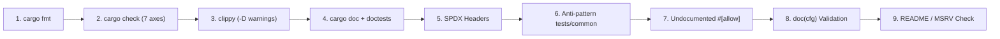
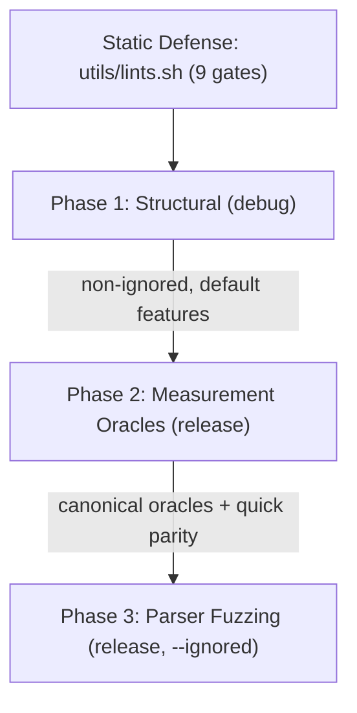

<!--
SPDX-License-Identifier: Apache-2.0
Copyright (c) 2026 Fábio Henrique de Lima Silva (fhl.bsb@gmail.com) All rights reserved.
-->

# Test Architecture

This document defines the organization, execution tiers, and validation principles of the test and static defense suite for `NeuralAmpModeler-rs`. The executable code (`tests/`, `src/**/*_test.rs`) and typed receipts are the primary source of truth.

> [!NOTE]
> **Document Scope & Hierarchy:**
>
> - **Static Analysis & Quality Defense:** Static validation across all feature axes, Clippy, doc-tests, and policy checks via [utils/lints.sh](../utils/lints.sh) (§2).
> - **Functional & Correctness Architecture:** Automated test architecture, feature gating, execution phases, and oracle validation via [utils/tests-quick.sh](../utils/tests-quick.sh) and [utils/tests-long.sh](../utils/tests-long.sh) (§3–§6).
> - **Manual Testing & Human Release Certification:** Step-by-step developer functional verification (Tiers 1–3) and the 5-receipt human release certification protocol reside in [functional-tests.md](functional-tests.md).
> - **Performance Regression Gates:** The statistical Criterion benchmarking wall and baseline governance reside in [benchmarks.md](benchmarks.md).
> - **Fixtures & Golden Vectors:** Ground-truth vector generation, model resolution order, and hash manifests reside in [fixtures.md](fixtures.md).
> - **Acoustic & Perceptual Validation:** Metric formulations (ESR, SNR, MR-STFT, THD+N) and perceptual calibration thresholds reside in [perceptual_validation.md](perceptual_validation.md).

---

## 1. Crate Features Taxonomy

The `NeuralAmpModeler-rs` crate defines several features in [Cargo.toml](../Cargo.toml) to configure runtime targets, test capabilities, and diagnostic facilities:

| Feature Name             | Default | Description                          | Active Scope & Modules                                                                                                   |
|:------------------------ |:-------:|:------------------------------------ |:------------------------------------------------------------------------------------------------------------------------ |
| **`dual-mono`**          | Yes     | Independent dual-channel inference   | [src/dsp/pipeline/stages/input.rs](../src/dsp/pipeline/stages/input.rs) (Stereo/dual-mono DSP variants)                  |
| **`testing`**            | No      | Test utilities, signals & generators | [src/testing/](../src/testing/), CLI binaries (`nam_golden_catalog`, `nam_freshness`, `nam_long_receipt`, etc.)          |
| **`heap-audit`**         | No      | Memory allocation interceptor        | [src/common/alloc_audit.rs](../src/common/alloc_audit.rs), [tests/rt_constraints/](../tests/rt_constraints/) heap checks |
| **`fft-radix4-planner`** | No      | Radix-4 FFT benchmark planner        | [benches/fft_radix4_bench.rs](../benches/fft_radix4_bench.rs) (Radix-4 DIT FFT planning routines)                        |
| **`avx512`**             | No      | Research/measurement AVX-512 kernels | [src/math/activations/](../src/math/activations/), SIMD dispatch tables                                                  |
| **`rt-hardening`**       | No      | Real-time OS host tuning (Linux)     | [src/rt_hardening/](../src/rt_hardening/) (THP, mlockall, SCHED_FIFO, DAZ/FTZ, IRQ affinity)                             |

---

## 2. Static Analysis & Quality Defense (`utils/lints.sh`)

[`utils/lints.sh`](../utils/lints.sh) is the **static first line of defense** of the project. It runs quickly (~45 seconds) and acts as an uncompromising quality gate that developers should execute regularly during active coding, before staging any commit, and as Receipt #1 in formal release certification.

Unlike test runners, `lints.sh` does not evaluate numerical audio outputs. Instead, it statically proves compilation cleanliness, zero-warning compliance, documentation hygiene, and policy conformance across the entire feature matrix.

### 2.1 The 9 Sequential Verification Gates



1. **`[1/9] In-Place Formatting (cargo fmt):`**
   Runs `cargo fmt --all` to enforce standard formatting across library code, binaries, examples, benches, and tests.
2. **`[2/9] Dynamic Compilation Matrix (cargo check):`**
   Verifies that the codebase compiles cleanly across 7 distinct feature axes, preventing hidden breakages behind conditional compilation:
   - Catch-all: `--all-targets --all-features`
   - Pure minimal core: `--lib --no-default-features`
   - All targets without defaults: `--all-targets --no-default-features`
   - Individual feature permutations: `fft-radix4-planner`, `dual-mono`, `testing`, `heap-audit`, and `rt-hardening`.
3. **`[3/9] Strict Static Analysis (cargo clippy):`**
   Executes Clippy across the same 7 feature permutations with `-D warnings`. Fails on any compiler or Clippy warning, dead code, or unidiomatic construct.
4. **`[4/9] Documentation & Doc-Tests (cargo doc + cargo test --doc):`**
   Builds full rustdoc documentation (`cargo doc --no-deps`) with zero warnings under `--all-features`, and executes every documentation test example in public APIs and README code blocks.
5. **`[5/9] SPDX License Notice Compliance:`**
   Scans every source code file to ensure the presence of the proper SPDX identifier comment and copyright notice (`Apache-2.0` for `NeuralAmpModeler-rs`).
6. **`[6/9] Anti-Pattern Enforcement in Tests:`**
   Ensures that helper files under `tests/common/` contain zero `#[test]` annotations, preventing duplicate or accidental executions outside official test entry points.
7. **`[7/9] Undocumented #[allow(...)] Policy Check:`**
   Enforces the project's zero-silent-suppression rule: every `#[allow(...)]` or `#![allow(...)]` compiler attribute must have an immediately preceding comment justifying why the lint suppression is necessary.
8. **`[8/9] doc(cfg) Annotation Consistency:`**
   Cross-references all `#[doc(cfg(feature = "..."))]` annotations against the declared features in [Cargo.toml](../Cargo.toml) to prevent orphan or mistyped documentation tags.
9. **`[9/9] Version & MSRV Synchronization:`**
   Asserts that the version and Minimum Supported Rust Version (MSRV `1.99.0`) stated in `README.md` exactly match [Cargo.toml](../Cargo.toml).

### 2.2 Developer Usage & Flags

```bash
# Standard interactive execution (runs at low CPU/IO priority to maintain machine responsiveness)
./utils/lints.sh

# Fast / normal priority execution (recommended in dedicated terminal sessions or CI)
NAM_NO_LOW_PRIORITY=1 ./utils/lints.sh
```

### 2.3 docs.rs Parity Check (Opt-in, Nightly)

The crate page published by docs.rs is rendered by **nightly** rustdoc with `--cfg docsrs`. Documentation diagnostics that only nightly reports — broken intra-doc links, redundant explicit link targets, and missing `doc(cfg(feature = "..."))` seals — are invisible to the stable `lints.sh` gate (§2.1, phase 4). [utils/docsrs-check.sh](../utils/docsrs-check.sh) mirrors the docs.rs configuration to catch those regressions before publishing.

```bash
# Opt-in: requires an isolated nightly toolchain (never part of the stable gates)
./utils/docsrs-check.sh
```

The script exports `DOCS_RS=1` and `RUSTDOCFLAGS="--cfg docsrs -D warnings"`, derives the feature scope from `package.metadata.docs.rs` in [Cargo.toml](../Cargo.toml), then runs `cargo +nightly doc --locked --lib --no-deps` with that scope (`--lib` mirrors the docs.rs build). Exit `0` means zero rustdoc warnings; exit `2` is a typed gap (nightly or metadata tooling unavailable); any rustdoc warning fails with exit `1`.

### 2.4 SemVer Baseline Check (Opt-in, Pre-release)

The published SemVer baseline is the **last release available on crates.io** (`0.8.0`), not the local `Cargo.toml` version. Before publishing, compare the current API surface against that baseline with [`cargo-semver-checks`](https://github.com/obi1kenobi/cargo-semver-checks):

```bash
# Release gate: the local version (1.0.0) is a major bump, so every intended
# break is already covered; a clean surface prints "no semver update required".
cargo semver-checks check-release --baseline-rev v0.8.0

# Enumeration aid (evidence only): force a non-major release type to list every
# breaking change relative to 0.8.0, so each one can be marked as intentional.
cargo semver-checks check-release --baseline-rev v0.8.0 --release-type minor
```

`--baseline-rev` resolves the baseline from the local `vX.Y.Z` git tag, avoiding a crates.io round-trip; `--baseline-version 0.8.0` is the registry equivalent. The tool requires an isolated nightly rustdoc toolchain and is an **opt-in, out-of-band** check: it is never part of the stable `utils/lints.sh` gate. Exit `0` from the release-gate form means the declared version bump covers every detected change. The `--release-type` form only selects which checks run; its exit code still reflects the declared version delta, so read the printed `Summary` line (not the exit code) when enumerating breaks. Reports are archived as PR/packaging evidence and are not committed as tool artifacts.

---

## 3. Test Execution Phase Architecture — Two-Axis Model

Test selection and execution are governed by **two orthogonal axes**:

- **Axis A — Rigor (`#[ignore]`):**
  - *Non-ignored:* First line of defense for daily local iteration. Fast, deterministic.
  - *`#[ignore]`*: Exhaustive audits, numerical soak, full proptest sweeps, and long parity matrices executed in nightly or pre-release runs.
- **Axis B — Codegen Path (Debug vs. `--release`):**
  - *Debug (`cargo test`):* Structural tests (logic, parsers, FSM transitions, bitwise determinism) execute with `debug-assertions` active. Float codegen optimizations are irrelevant here.
  - *Release (`cargo test --release`):* Measurement oracles (evaluating floating-point outputs against reference models) must execute under release optimization (`-O3`, FMA contraction, vectorization). Measuring floats in debug checks an unoptimized codegen path that does not reflect production runtime behavior.



### 3.1 Quick QA Suite (`utils/tests-quick.sh`)

The quick suite executes in approximately 2 minutes (depending on hardware and previous caching) and encompasses three distinct phases:

1. **Phase 1 — Structural (Debug, default features):**
   - **Scope:** Unit tests (`--lib`) plus integration entry points ([tests/models.rs](../tests/models.rs), [tests/perf_soak.rs](../tests/perf_soak.rs), [tests/parity.rs](../tests/parity.rs), [tests/dsp_core.rs](../tests/dsp_core.rs), [tests/cabsim_stereo.rs](../tests/cabsim_stereo.rs), [tests/target_features_compliance_test.rs](../tests/target_features_compliance_test.rs), [tests/libm_export_guard.rs](../tests/libm_export_guard.rs)).
   - **Exclusions:** Measurement oracles (deferred to Phase 2), timing characterization (`rt_deadline`/`rt_jitter`, deferred to long suite), and parser fuzzing (deferred to Phase 3).
2. **Phase 2 — Measurement Oracles (Release):**
   - **Scope:** Evaluates production float paths across mathematical reference oracles (`reference_oracle_f64`, `spectral_fidelity`, `linear_fft_test`), committed golden vectors (`golden_vectors` v1, `isa_parity` v2), and live C++ parity (`cpp_parity quick_parity`).
   - **Gaps:** Missing optional fixtures or C++ render tools emit diagnostic warnings (`WARN`) and mark the receipt as `FIDELITY: INCOMPLETE`. Running with `NAM_QUICK_STRICT=1` promotes gaps to a hard failure (`EXIT 1`).
3. **Phase 3 — Parser Fuzzing (Release, `--ignored`, capped):**
   - **Scope:** Proptest parser sweeps ([tests/models/proptest_parsers.rs](../tests/models/proptest_parsers.rs)) capped at 1,000 cases (`NAM_QUICK_PROPTEST_CASES=1000`).

### 3.2 Golden Vector Supply Chain & Freshness

Golden vectors validate inference determinism against pre-rendered reference outputs:

- **Freshness Manifest:** [tests/fixtures/golden_gen_build.sh](../tests/fixtures/golden_gen_build.sh) maintains the versioned `.golden_manifest.sha256` digest manifest. Phase 2 verifies this integrity gate using `src/testing/freshness.rs` (`nam_freshness`). Any model modification without golden regeneration triggers a hard failure.
- **Model Resolution Order:** Models are resolved hierarchically: (1) `$NAM_MODELS_DIR`, (2) `third-party/community_models/`, (3) `tests/fixtures/models-nondist/`, (4) `tests/fixtures/models/`. Details are documented in [fixtures.md](fixtures.md).

### 3.3 Binary Defense & Compile-Time Segregation

- **Libm Export Guard:** [tests/libm_export_guard.rs](../tests/libm_export_guard.rs) is a fail-closed ELF symbol gate executed on the linked binary artifact in `tests-quick.sh` Phase 1 and `tests-long.sh` Phase 2. It ensures internal `libm` mathematical symbols are hidden and cannot interpose over system C library symbols.
- **AVX-512 Segregation Contract:** AVX-512 code is strictly segregated at compile time via `#[cfg(feature = "avx512")]`. Default builds monomorphize only `Avx2Math`; no EVEX or ZMM opcodes are generated in default release artifacts. Runtime hardware capabilities and effective dispatch status are inspected using [`utils/simd-probe.sh`](../utils/simd-probe.sh) ([src/bin/simd_probe.rs](../src/bin/simd_probe.rs)).

---

## 4. Test Placement Rules

Test location is strictly governed by scope and size:

| Axis                                                          | Rule                                       | Execution Target                                                                                         |
|:------------------------------------------------------------- |:------------------------------------------ |:-------------------------------------------------------------------------------------------------------- |
| Structural / logic / parsers / FSM / bitwise                  | Non-ignored, **Debug**                     | `tests-quick.sh` Phase 1 (`--lib` + modular integration entry points)                                    |
| Production float measurement oracles                          | Non-ignored, **`--release`**               | `tests-quick.sh` Phase 2 (`golden_vectors`, `cpp_parity quick_parity`, f64 oracle, spectral, linear FFT) |
| Capped parser fuzzing                                         | `#[ignore]`, **`--release`**, capped cases | `tests-quick.sh` Phase 3 (`proptest_parsers`)                                                            |
| Exhaustive matrix / soak / heap-audit / RT / Loom model check | `#[ignore]` or feature-gated               | `tests-long.sh` (Phases 1–7)                                                                             |

Any test marked `#[ignore]` without an invocation in `tests-long.sh` or an explicit on-demand reason comment (`// on-demand:`) is considered an orphan.

### 4.1 Unit Test Placement & The 300-Line Rule

Unit tests adhere to strict source organization rules:

- **Files < 300 source lines:** Tests are declared inline within an embedded module:

  ```rust
  #[cfg(test)]
  mod tests {
      use super::*;
      // ...
  }
  ```

- **Files ≥ 300 source lines:** Tests are extracted to a dedicated sibling file `<module>_test.rs` and included via:

  ```rust
  #[cfg(test)]
  #[path = "<module>_test.rs"]
  mod tests;
  ```

- **Off-RT Boundary:** Test utilities, golden generators, and off-RT validation helpers reside in `src/testing/` — never in `src/dsp/` or hot-path audio processing modules.

### 4.2 Modular Integration Entry Points

Integration tests are partitioned into cohesive entry points under `tests/`:

- [tests/models.rs](../tests/models.rs): Model instantiation, architecture validation, and golden vector comparisons.
- [tests/parity.rs](../tests/parity.rs): Reference oracle comparisons (f64, C++ NAMCore live parity, cross-ISA parity).
- [tests/perf_soak.rs](../tests/perf_soak.rs): Numerical soak, thread contention, and long-running endurance checks.
- [tests/rt_constraints.rs](../tests/rt_constraints.rs): Real-time constraints, zero heap allocation audits, deadline, and jitter telemetry.
- [tests/dsp_core.rs](../tests/dsp_core.rs): Resamplers, noise gate FSM, circular buffers, and DSP pipeline stages.
- Standalone harnesses: `cabsim_stereo.rs`, `libm_export_guard.rs`, `qa_defense.rs`, `loom_tests.rs`.
- Integration & regression shell suites:
  - [`tests/scripts/test_regression_guard.sh`](../tests/scripts/test_regression_guard.sh): Automated regression harness validating performance regression gate fail-closed behavior, contract format validation, PERF-006 domain separation, log truncation, and baseline store nesting sanitization (§14).

---

## 5. Decoupled Long QA Audits (`utils/tests-long.sh`)

The long-duration stress and audit suite executes comprehensive numerical validation, full-count proptests, live C++ parity, memory audits, and real-time deadline tests (~10 minutes, depending on hardware).

### 5.1 Blocking Preflight Gates

Before entering timed test execution, six preflight steps run:

1. **`preflight-render`:** Validates or builds the upstream C++ reference `render` CLI via `utils/ensure_namcore_render.sh`.
2. **`preflight-catalog`:** Asserts the presence and integrity of all required model fixtures and V1/V2 goldens registered in [src/testing/catalog.rs](../src/testing/catalog.rs). Enforces the strict counting invariant: `present + missing_required.len() + missing_optional.len() + known_gap_files == fixtures_checked`.
3. **`preflight-package`:** Checks crate packaging hygiene via `cargo package --list`.
4. **`preflight-freshness`:** Verifies SHA-256 integrity against `tests/fixtures/.golden_manifest.sha256`.
5. **`preflight-meta`:** Validates catalog-to-test coherence via [tests/models/meta_coherence.rs](../tests/models/meta_coherence.rs).
6. **`preflight-simd-probe` (Diagnostic):** Runs `simd_probe` to record host SIMD feature bits, OS AVX-512 state, and dispatched engine. Non-gating.

### 5.2 Sequential Execution Phases

1. **Phase 1 — Soak & Concurrency:** 10M+ frames continuous endurance testing, SPSC queue contention sweeps ([tests/perf_soak/](../tests/perf_soak/)).
2. **Phase 2 — Defense Scripts & Invariant Tests:** Rust defense harness ([tests/qa_defense.rs](../tests/qa_defense.rs)) asserting metric sanitization, classification, freshness edge cases, and dynamic linker export guards ([tests/libm_export_guard.rs](../tests/libm_export_guard.rs)).
3. **Phase 3 — Exhaustive Matrix & Parity:** Full C++ NAMCore live parity matrix, multi-sample-rate V2 goldens, cross-ISA validation, spectral fidelity baselines, and full 100k-case proptests.
4. **Phase 4 — Heap Audit:** Strict verification of zero heap allocations on the audio processing hot path (`CountingAllocator` via `--features heap-audit`, including resampler, cabsim, A2 standard, A2-Max dynamic `test_a2_dyn_max_heap_audit`, and sequential chains).
5. **Phase 5 — RT Deadline Gate:** Processing budget enforcement ($p99 < 1.33\text{ ms}$ for 64-sample blocks at 48 kHz across all SKUs, including A2-Max `test_rt_deadline_a2_max`). Measured using high-resolution `LatencyHistogram` (256 log-linear sub-bins, relative error bound $\le 12.5\%$) paired with `ExactLatencyReservoir` for exact $p99$ arbitration.
6. **Phase 6 — RT Jitter Telemetry:** Measures processing latency distribution under simulated CPU contention (`stress-1`, `stress-2`, `saturate-N`) across $\ge 16384$ blocks with initial 512-block cache/branch warmup to eliminate cold-start transients. Latency distributions are collected using `LatencyHistogram`.
7. **Phase 7 — Concurrency Model Checking:** Loom model verification for lock-free queues and atomic bitmasks (`--cfg loom`).

### 5.3 Structured Audit Receipt (`long-audit-receipt.jsonl`)

Each phase appends a structured record to `target/logs/long-audit-receipt.jsonl` using the Rust binary `nam_long_receipt`:

```json
{
  "phase_id": "phase1",
  "name": "Soak Tests (Numerical Stability)",
  "status": "PASSED",
  "duration_ms": 42000,
  "tests_executed": 26,
  "gaps": [],
  "timestamp": "2026-08-14T03:00:00Z"
}
```

- **Receipt Statuses:** `PASSED`, `FAILED`, `SKIPPED`, `INCONCLUSIVE`, `SKIP_CAPABILITY`, `NOT_RUN`, `SIMULATED`. The suite line uses `PASSED`, `FAILED`, `COMPLETED_WITH_GAPS`, or `SIMULATED`.

- **Aggregated Overall Gaps:** The terminal `overall` record aggregates the deduplicated union of gaps from all phases prefixed by `phase_id` (`<phase_id>:<gap_id>`), guaranteeing full traceability and exact match with `overall.gaps.len()`.

- **Performance Regression Integration:** The `PERF_REGRESSION` human summary line is evaluated dynamically from `target/logs/regression_phase_receipt.jsonl` (within 24 hours / matching run ID). If absent or simulated, it emits `NOT_RUN`. Any failed regression evaluates to `FAIL`, promotes `OVERALL` to `FAILED`, emits `ERROR: perf_regression — FAILED`, and causes `utils/tests-long.sh` to fail closed.

- **Simulated Receipts:** `utils/tests-long.sh --simulate` (alias `--dry-run`) pre-registers the six preflights and seven phases as `SIMULATED` with `tests_executed: 0` without executing any test. The derived suite line is `SIMULATED` and every verdict line reads `NOT_RUN` (`FIDELITY`, `RT_DEADLINE`, `RT_JITTER`, `PERF_REGRESSION`) — a simulated receipt never prints `OK`/`PASS`, and `--strict-pre-release` always rejects it.

- **Typed Markers:** Discrepancies or skips must emit recognized markers parsed into typed gaps:

  - `[STATUS] SKIP_CAPABILITY reason="<detail>"`: Hardware or ISA absence.
  - `[STATUS] SKIP_OPTIONAL reason="<detail>"`: Missing non-distributable optional model.
  - `[STATUS] KNOWN_GAP id="<id>" reason="<detail>"`: Upstream gap under active tracking.
  - `[STATUS] INCONCLUSIVE reason="<detail>"`: Measurement bypass in non-calibrated environments.

- **Fail-Closed Invariant:** `overall: PASSED` is emitted only when all phases complete with `gaps: []` and no timed phase executed zero tests. `nam_long_receipt validate` is a **semantic** verifier — never a substring search: it enforces the canonical roster (`CANONICAL_ROSTER`: 6 preflights + `phase1`..`phase7` + terminal `overall`), rejecting empty/partial receipts, missing/duplicate/unknown IDs, a timed phase that claims `PASSED` with zero executed tests, and a declared `OVERALL:` verdict that disagrees with the verdict derived from the phase/gap evidence (a forged/injected `OVERALL: PASSED` line — including one pasted into a comment — is rejected at parse time). In strict mode (`--strict`) it additionally rejects any declared gap or failure. Verification is enforced via:

  ```bash
  cargo run --locked --features testing --bin nam_long_receipt -- validate --strict --out target/logs/long-audit-receipt.jsonl
  ```

  The roster is a parameter (`LongAuditReceipt::semantic_verdict_with_roster` /
  `campaign_strict_verdict_with_roster`) so downstream producers (hosts,
  standalone applications, plugins) reuse the exact schema and semantics with
  their own phase matrix.

- **Referenced-Artifact Provenance:** each JSONL line may carry the optional
  SHA-256 of the artifacts that backed its verdict — `oracle_sha256`,
  `fixture_sha256`, `artifact_sha256` (producer-neutral names; no host-specific
  field is ever encoded). The fields are omitted when absent
  (`skip_serializing_if`) and default when absent on read (`#[serde(default)]`),
  so historical goldens remain byte-compatible. `nam_long_receipt append`
  accepts `--oracle-sha256` / `--fixture-sha256` / `--artifact-sha256`.

### 5.4 Build Target Segregation (`CARGO_TARGET_DIR`)

To eliminate wasteful full recompilations caused by feature flag or compiler flag switches across phases (e.g. `release-default` vs `--features heap-audit` vs `RUSTFLAGS="... --cfg loom"`), `utils/tests-long.sh` segregates build outputs into profile-specific subdirectories under `target/long/`:

- `target/long/release-default`: Used by preflights and phases 1, 2, 3, 5, and 6.
- `target/long/release-heap-audit`: Used by phase 4 (heap-audit).
- `target/long/loom`: Used by phase 7 (loom model checking).

This segregation ensures that repeated runs reuse build artifacts across phases, significantly accelerating subsequent test cycles.
Note: Profile segregation increases transient disk space usage under `target/` (~1.5–2 GB additional). If disk space is constrained or for debugging purposes, setting `NAM_LONG_SHARED_TARGET=1` acts as a rollback switch to restore a single shared `target/` directory.

---

## 6. Ignored-Test Policy

Tests annotated with `#[ignore]` represent rigorous or long-duration validations, not deprecated code. Every ignored test must belong to one of two categories:

1. Invoked by `utils/tests-long.sh` during nightly or pre-release auditing.
2. Accompanied by an explicit on-demand reason in the source comments (`// on-demand: <reason>`), explaining when and how it should be run manually.

---

## 7. Execution Policies & Operator Delegation

The test framework applies two distinct execution paradigms depending on the operational goal:

### 7.1 Fail-Fast Policy (`utils/tests-quick.sh`)

- **Goal:** Minimize feedback latency during local development and pre-commit checks.
- **Behavior:** Halts immediately on the first failure (`set -e`, standard bash error traps).

### 7.2 Complete View Policy (`utils/tests-long.sh`)

- **Goal:** Provide a comprehensive status report across all functional domains for pre-release and nightly certification.
- **Behavior:** Continues through all phases despite individual target failures (`|| true`), aggregating logs and compiling the final audit receipt.

### 7.3 Operator Delegation

The long audit suite (`utils/tests-long.sh`), baseline renewal (`utils/tests-performance-regression.sh --bootstrap-baseline`), and contract snapshots (`utils/quality-dashboard.sh --save`) are executed **exclusively by human operators** on calibrated, isolated machines. The complete manual testing protocol and release certification checklist reside in [functional-tests.md](functional-tests.md).

The performance gate is **fail-closed**: a missing baseline is `MISSING_BASELINE`, and a fingerprint drift (CPU model, ISA, toolchain, governor, pinned core) is `INCOMPARABLE_ENVIRONMENT` — neither silently re-creates or ignores a baseline; renewal is an explicit operator operation under a calibrated environment. The baseline fingerprint schema also records audit and provenance metadata (`git_commit`, optional `git_dirty`, and optional `cargo_lock_sha256`). Divergence in these audit fields emits informational diagnostic warnings to `stderr` without failing the gate, preserving strict backward compatibility with legacy baseline files. The gate binary `nam_perf_gate` is reusable by downstream suites (installed via `cargo install NeuralAmpModeler-rs --features testing --bin nam_perf_gate`, or `NAM_PERF_GATE`); `coverage`/`expected-count`/`verdict` accept an external `--manifest` of expected ids (trailing-`*` group patterns) so any Criterion suite is verified without engine-internal names. See [benchmarks.md §4](benchmarks.md) for the full contract.

---

## 8. Measurement & Perceptual Validation Framework

Audio fidelity assessment combines physical error metrics with perceptual domain envelopes, documented in [perceptual_validation.md](perceptual_validation.md).

### 8.1 Integration with Test Targets

| Test Target                 | Metrics Evaluated                                 | Purpose                                                    |
|:--------------------------- |:------------------------------------------------- |:---------------------------------------------------------- |
| **`cpp_parity`**            | ESR, SNR, PSNR, MSE, MAE, Anchor SNR              | Interoperability with upstream C++ reference               |
| **`golden_vectors`**        | Per-model ESR thresholds, MSE, SNR                | Long-term regression gate against frozen binary outputs    |
| **`isa_parity`**            | ESR cross-ISA budgets, self-consistency (MSE = 0) | Architectural determinism across AVX2, AVX-512, and scalar |
| **`spectral_fidelity`**     | ASR, Farina FR+THD, THD+N (AES17), IMD (SMPTE)    | Aliasing and non-linear distortion characterization        |
| **`reference_oracle_f64`**  | ESR (f64 vs. f32), decomposed error sources       | Numerical ideality and activation precision budgeting      |
| **`threshold_calibration`** | Per-model ESR/SNR baselines, Fidelity Margins     | Calibration and noise-envelope definition                  |

### 8.2 Core Principles

- **Dual Reference Systems:** Parity (C++ NAMCore f32) measures implementation alignment; absolute fidelity (f64 Oracle) measures intrinsic precision loss from single-precision approximations. Discrepancies between both references mandate review; neither oracle overrides the other unconditionally.
- **Energy-to-Signal Ratio (ESR) & Signal-to-Noise Ratio (SNR):** Exact zero comparisons (`noise_power == 0.0`, `signal_power == 0.0`) govern edge conditions. Bit-identical parity yields `SNR = +∞` (and `ESR = 0.0` / `ESR_dB = -∞`). Any non-zero error energy, even at the sub-epsilon numerical noise floor ($\sim 10^{-16}$, e.g. 5–6 ULPs across samples), yields finite logarithmic values, preventing false infinities during high-fidelity model validation.
- **Off-RT Execution:** All perceptual and spectral metrics allocate memory and run strictly off-RT. Hot-path audio threads use sample-peak detection only.

### 8.3 Cross-ISA Verification & Declared Skips (`SKIP_CAPABILITY`)

The test suite enforces a strict boundary between **single-architecture determinism** and **cross-ISA numerical parity**:

1. **Declared Skips (`SKIP_CAPABILITY`):**

   - The engine targets `x86-64-v3` (AVX2, FMA, BMI2) on x86_64 and NEON on aarch64 as its strict compile-time baselines. On host machines without AVX-512 hardware or when compiling without `--features avx512`, AVX-512 execution paths cannot physically run.

   - Tests in [tests/parity/isa_parity.rs](../tests/parity/isa_parity.rs) detect missing hardware capabilities or disabled Cargo features via `skip_if_unsupported!` and emit machine-parseable markers:

     ```text
     [STATUS] SKIP_CAPABILITY reason="<reason>:<test_name>"
     ```

   - In local runs and the QA dashboard ([utils/quality-dashboard.sh](../utils/quality-dashboard.sh)), only the AVX2-vs-AVX2 self-consistency check executes (`isa_self_consistency`). The inter-ISA matrix (`isa_parity_cross_isa`) is declared as an explicit gap (`cross_isa_matrix_requires_avx512_remote`), avoiding false failures while preventing unvetted assumptions.

2. **`FIDELITY: OK` Scope Boundary:**

   - A local test run reporting `FIDELITY: OK` validates that all active single-architecture mathematical reference oracles (`reference_oracle_f64`), committed golden vectors (`golden_vectors`), and C++ reference parity (`cpp_parity`) passed within contractual error budgets on the local host architecture.
   - **`FIDELITY: OK` does NOT cover cross-ISA parity.** Local self-consistency (AVX2 vs. AVX2) guarantees local determinism (an MSE = 0 tautology), not mathematical or numerical parity across differing SIMD instruction sets.

3. **Remote SIMD Verification (`utils/remote-simd-gate.sh`):**

   - Full cross-ISA parity gating (AVX2 vs. AVX-512) and comparative SIMD micro-benchmarks must be executed on AVX-512 hardware or under emulation using [utils/remote-simd-gate.sh](../utils/remote-simd-gate.sh):

     ```bash
     # Execute locally under Intel SDE emulator:
     ./utils/remote-simd-gate.sh --sde

     # Execute on a remote machine with native AVX-512 hardware via SSH:
     ./utils/remote-simd-gate.sh user@remote-host

     # Specify custom destination for the receipt JSON:
     ./utils/remote-simd-gate.sh --out target/logs/remote-simd-receipt.json user@remote-host
     ```

   - The script compiles with `--features avx512 --include-ignored`, executes the full `isa_parity` test battery across all topologies, and validates the resulting receipt `target/logs/remote-simd-receipt.jsonl` using Criterion statistical confidence intervals ($p < 0.05$).

---

## 9. Test Value Hierarchy

Tests are categorized into three hierarchical tiers based on the guarantees they provide:

| Tier    | Category                                                     | Primary Guarantee                                | Execution Target                 |
|:-------:|:------------------------------------------------------------ |:------------------------------------------------ |:-------------------------------- |
| **1🔴** | Upstream parity (`golden_vectors`, `cpp_parity`)             | Compatibility with the NAM ecosystem             | Quick Phase 2 + Long Phase 3     |
| **1🔴** | Real-time safety (`heap-audit`, zero-alloc hot-path)         | Zero dynamic allocation on audio thread          | Long Phase 4                     |
| **1🔴** | Parser security & robustness (`.nam` / `.namb` fuzzing, CRC) | Memory safety and format integrity under attacks | Quick Phase 3 + Phase 1          |
| **2🟠** | Spectral fidelity (ASR, Farina FR+THD, THD+N AES17)          | Clean frequency response and low aliasing        | Quick Phase 2                    |
| **2🟠** | Mathematical correctness (vs. `f32::tanh` / `f64::tanh`)     | Activation approximations within tolerance       | Quick Phase 1                    |
| **2🟠** | f64 Oracle, Cross-ISA determinism, RT deadline budget        | Absolute precision, portability, and latency     | Quick Phase 2 + Long Phases 3, 5 |
| **3🟡** | Kernel regression locators (`avx2_vs_scalar`, GEMV, conv)    | Pinpoint localized SIMD regression sites         | Quick Phase 1                    |
| **3🟡** | Approximation consistency checks (`nr2_vs_nr1`, Padé)        | Relative numerical stability across variants     | Long Phase 3                     |
| **3🟡** | Proptest mathematical invariant sweeps                       | Stochastic exploration of numerical edge cases   | Quick Phase 1 + Long Phase 3     |

### 9.1 Stochastic Proptest Tolerance Scaling

When executing property-based tests across randomized input vectors ($N \le 1024$ in $[-1.0, 1.0]$), accumulated single-precision rounding error scales with vector length and magnitude. Tolerances must be scaled by the $L_1$ norm of the product terms to prevent cancellation false positives:

$$\text{threshold} = 10^{-6} \times \max\left(1.0, \sum_{i=1}^N |x_i \cdot y_i|\right)$$

### 9.2 Virtualized & Cloud Execution Caveats

When running audits inside virtualized environments (e.g., cloud VMs):

- **Timing & Jitter (Phases 5 & 6):** Hypervisors cannot guarantee hard-real-time clock stability or dedicated CPU governors. The suite detects virtualized environments and classifies jitter deviations as `INCONCLUSIVE`, preventing false failures on hard functional gates.
- **SIMD Micro-benchmarking:** Gating scripts (`utils/remote-simd-gate.sh`) use Criterion statistical confidence intervals ($p < 0.05$) to ensure decisive comparative evaluations across ISAs.

---

## 10. Quality Contract

The Quality Contract establishes an immutable baseline that freezes audio fidelity and inference latency to prevent silent regressions.

### 10.1 Architecture & Governance

The contract is governed by [utils/quality-dashboard.sh](../utils/quality-dashboard.sh) against the canonical schema file [docs/quality-contract.json](quality-contract.json):

```bash
# Check current build against baseline contract
./utils/quality-dashboard.sh --check docs/quality-contract.json

# Freeze current results as the baseline contract (Human operator only)
./utils/quality-dashboard.sh --save docs/quality-contract.json
```

The contract schema is enforced via typed serde structures in `src/testing/qa/`.

### 10.2 Tolerance Envelopes

The `--check` mode distinguishes measurement noise from true regressions:

| Metric Domain                  | Failure Criterion                                                                            | Rationale                                                |
|:------------------------------ |:-------------------------------------------------------------------------------------------- |:-------------------------------------------------------- |
| **Fidelity — ESR**             | Dynamic noise envelope: $\max(\text{baseline} \times 3, \text{baseline} + 5\times 10^{-14})$ | Detects subtle 2×–5× regressions on ultra-precise models |
| **Fidelity — SNR**             | $\text{SNR}_{\text{new}} < \text{SNR}_{\text{contract}} - 6.0\text{ dB}$                     | Absorbs minor quantization and scheduling variance       |
| **Fidelity — MR-STFT**         | Envelope ceiling vs. contract                                                                | Limits multi-resolution spectral drift                   |
| **Oracle Divergence**          | `REVIEW_REQUIRED` if NAMCore and f64 diverge in opposing directions                          | Enforces human review when oracles disagree              |
| **Performance — Latency (µs)** | $\text{Latency}_{\text{new}} > \text{Latency}_{\text{contract}} \times 1.10$                 | 10% tolerance absorbs background OS scheduling noise     |

> [!IMPORTANT]
> **Decoupling Fidelity from Performance:**
> Latency deviations do **not** constitute audio degradation. The verification pipeline reports these domains independently:
>
> - `FIDELITY: OK` / `PERFORMANCE: NOT_VERIFIED`: All mathematical and audio fidelity checks passed; only benchmark timings varied. Sonic output is intact. Note: as detailed in §8.3, `FIDELITY: OK` reflects local single-architecture validation and does not cover cross-ISA parity between AVX2 and AVX-512.
> - `FIDELITY: FAIL`: Numerical or spectral degradation detected. Requires immediate DSP investigation.
>
> Primary statistical authority for performance regressions belongs to [utils/tests-performance-regression.sh](../utils/tests-performance-regression.sh) via Criterion confidence intervals; the quality contract serves as an integrated secondary check.

---

## 11. Utility Scripts Inventory

The `utils/` directory provides deterministic defense tools, inspection utilities, and test runners:

| Script                                                                                | Responsibility                       | Guarantees & Operation                                                                                                                                                                                                                                                                                                                               |
|:------------------------------------------------------------------------------------- |:------------------------------------ |:---------------------------------------------------------------------------------------------------------------------------------------------------------------------------------------------------------------------------------------------------------------------------------------------------------------------------------------------------- |
| **[`utils/lints.sh`](../utils/lints.sh)**                                             | Static analysis & quality defense    | 9 automated gates: in-place `fmt`, compilation & Clippy across 7 feature axes, `cargo doc`+doctests, SPDX, and policy checks (§2).                                                                                                                                                                                                                   |
| **`utils/tests-quick.sh`**                                                            | Agile first-line test suite          | Three-phase gate (Phase 1: unit + structural integration `models`, `perf_soak`, `parity`, `dsp_core`, `cabsim_stereo`, `target_features_compliance_test`, `libm_export_guard`, `freshness_guard`, `isa_contract`, `pipeline_capture_test`, `state_compat`; Phase 2: release float oracles; Phase 3: capped parser fuzzing). Runs in ~2 minutes (§3). |
| **`utils/tests-long.sh`**                                                             | Nightly & pre-release audit suite    | 6 preflights + 7 exhaustive stress and verification phases (~10 min). Emits structured JSONL receipts (§5). Nightly & human operator execution.                                                                                                                                                                                                      |
| **`utils/_lib.sh`**                                                                   | Shared shell library                 | Dynamic project path resolution, log formatting, process priority management, QA-binary resolution and typed receipt helpers. Sourcing it pulls in the canonical, project-neutral core `utils/_lib_core.sh`.                                                                                                                                         |
| **`utils/_lib_core.sh`**                                                              | Canonical core shell primitives      | Shared, project-neutral core library (byte-identical across the NAM ecosystem, drift-pinned by `utils/test-lib-drift.sh`). Contains ANSI formatting, CPU governor probing, core isolation discovery (`pick_bench_core`), and subshell execution helpers.                                                                                             |
| **`utils/quality-dashboard.sh`**                                                      | Quality contract manager             | Executes fidelity and latency matrices; verifies or updates `docs/quality-contract.json` (§10). Periodic / on-demand evaluation.                                                                                                                                                                                                                     |
| **`utils/tests-performance-regression.sh`**                                           | Performance regression wall          | Baseline-gated Criterion evaluation; statistical confidence interval verification against ±5% noise bands. On-demand execution.                                                                                                                                                                                                                      |
| **`utils/setup-third-party.sh`**                                                      | Upstream vendor mirror manager       | Clones or updates pinned commits of `NeuralAmpModelerCore` and `NeuralAmpModelerPlugin`.                                                                                                                                                                                                                                                             |
| **`utils/ensure_namcore_render.sh`**                                                  | C++ Reference Render Builder         | Idempotently builds the C++ NAMCore render binary for parity oracles.                                                                                                                                                                                                                                                                                |
| **`utils/simd-probe.sh`**                                                             | SIMD diagnostic CLI wrapper          | Diagnostic / spot-check CLI: reports CPU SIMD capabilities, OS AVX-512 state, and active dispatch backend with checksums.                                                                                                                                                                                                                            |
| **`utils/check-model.sh`**                                                            | Model inspection CLI wrapper         | Diagnostic / spot-check CLI: inspects `.nam` (JSON) and `.namb` (binary) models, reporting topology, metadata, and tensors.                                                                                                                                                                                                                          |
| **`utils/remote-simd-gate.sh`**                                                       | Remote SIMD benchmarking             | Targeted remote gate: executes automated comparative benchmarking on remote AVX-512 hardware instances via SSH.                                                                                                                                                                                                                                      |
| **`utils/test-pick-bench-core.sh`**                                                   | Bench-core helper unit tests         | Unit test suite: synthetic tests with mocked sysfs trees validating `pick_bench_core` branches (canonical in `utils/_lib_core.sh`).                                                                                                                                                                                                                  |
| **`utils/test-lib-drift.sh`**                                                         | Shell-core drift guard               | Shell-core drift guard: recomputes SHA-256 for the canonical `utils/_lib_core.sh` region and `utils/dsp-hotpath-filter.py` body (ignoring SPDX header), failing closed on drift.                                                                                                                                                                     |
| **`utils/dsp-hotpath-filter.py`**                                                     | Unified RT-codegen filter & gate     | Unified disassembly filter: gates `zmm`/`libm`/`alloc`/`div`/`tls` symbols, with `--test-synthetic-violation`. Body is drift-pinned by `utils/test-lib-drift.sh`.                                                                                                                                                                                    |
| **`utils/codegen-profile.json`**                                                      | Codegen symbol profile               | Engine symbol profile and gate specifications consumed by `verify-kernel-codegen.sh` and the unified filter.                                                                                                                                                                                                                                         |
| **`utils/verify-kernel-codegen.sh`**                                                  | Kernel static-codegen guard (opt-in) | Operator / on-demand guard: disassembles a release binary containing kernel symbols (e.g., `examples/offline_render`, `strip=false`) and applies the unified filter with the engine profile.                                                                                                                                                         |
| **`utils/miri-audit.sh`**                                                             | Miri UB/aliasing audit (opt-in)      | Out-of-band audit: provenance and aliasing verification under the Miri MIR interpreter (Stacked/Tree Borrows) on lock-free targets. Requires isolated nightly; **never** run in stable gates (§13).                                                                                                                                                  |
| **`utils/mem-guard.sh`**                                                              | Host memory containment wrapper      | Transparent systemd user scope wrapper (`MemoryHigh=5G`, `MemoryMax=6G`, `oom_score_adj=500`) protecting the host and IDE against global OOM killer events during heavy builds/audits (§16).                                                                                                                                                         |
| **[`utils/docsrs-check.sh`](../utils/docsrs-check.sh)**                               | Docs.rs parity check (opt-in)        | Out-of-band check: simulates the docs.rs build environment under nightly rustdoc (`--cfg docsrs -D warnings`) to validate intra-doc links and `doc(cfg)` attributes (§2.3).                                                                                                                                                                          |
| **[`utils/mod-update.sh`](../utils/mod-update.sh)**                                   | Supply chain update pipeline         | Supply chain update pipeline: updates Rust toolchain (`rustup update`), updates `Cargo.toml` specifications (`cargo upgrade`), and synchronizes `Cargo.lock` (`cargo update`).                                                                                                                                                                       |
| **[`utils/render-a2-dumps.sh`](../utils/render-a2-dumps.sh)**                         | Forensic A2-Max tensor dumps         | Offline / forensic utility: regenerates intermediate activation dumps for A2-Max (`tests/fixtures/dumps_a2_max/`) using the C++ instrumentation in `utils/namcore-a2-dumps.patch`.                                                                                                                                                                   |
| **[`utils/namcore-a2-dumps.patch`](../utils/namcore-a2-dumps.patch)**                 | C++ A2 activation patch              | Tracked Git patch for `NeuralAmpModelerCore` v0.6.0 instrumenting per-layer intermediate activations in the A2-Max model.                                                                                                                                                                                                                            |
| **[`utils/debug/repro_oversample_hang.sh`](../utils/debug/repro_oversample_hang.sh)** | Debug safety wrapper for hangs       | Diagnostic safety harness for manual thread-hang reproduction under systemd scopes (`RuntimeMaxSec`, cgroup v2, resource isolation) with guaranteed teardown of descendant processes (§15).                                                                                                                                                          |

---

## 12. Code Coverage (Optional Development Aid)

Code coverage is not an official quality gate. Developers wishing to analyze coverage locally may install `cargo-llvm-cov` and execute:

```bash
cargo llvm-cov --features testing
```

Coverage reports serve as an informative diagnostic tool and are excluded from official verification scripts.

---

## 13. Out-of-Band Miri Concurrency & Aliasing Audit (`utils/miri-audit.sh`)

Standard release, CI, and long audit gates remain strictly **stable-only** ([§2](#2-static-analysis--quality-defense-utilslintssh), [§5](#5-decoupled-long-qa-audits-utilstests-longsh)). The `nightly` toolchain is never used by automated gates; it is used strictly on demand for isolated, out-of-band developer audits (`utils/miri-audit.sh` and `utils/docsrs-check.sh`).

To verify formal pointer provenance and
compliance with the Stacked Borrows / Tree Borrows aliasing models on the unsafe lock-free
primitives, an **opt-in, out-of-band** audit tool is provided (requires an isolated nightly
toolchain plus the `miri` component):

```bash
# Optional manual audit (NOT part of lints.sh / tests-quick.sh / tests-long.sh):
./utils/miri-audit.sh
```

**Relationship to Loom.** Miri *complements* `loom` (`utils/tests-long.sh` phase 7) and does not
replace it: `loom` exhaustively explores atomic interleavings to prove the **absence of data
races**, whereas Miri interprets concrete executions to prove **pointer provenance / aliasing
validity** (UB detection) that `loom` cannot see.

**Target matrix** (each target fails closed unless it executes a real minimum number of tests;
full log at `target/logs/miri-audit.log`):

| Target (`--lib` filter)  | Min tests | Notes                                                                                                                                      |
|:------------------------ |:---------:|:------------------------------------------------------------------------------------------------------------------------------------------ |
| `common::spsc`           | 28        | SPSC ring, GC cascade/overflow, status flags.                                                                                              |
| `dsp::pipeline::bridge`  | 4         | `DspBridge` double-buffer lock-free protocol (interior mutability via `UnsafeCell`).                                                       |
| `dsp::mirror_buf`        | 3         | Mirrored-buffer state machine; the `memfd_create`/`mmap` allocation tests are `#[cfg_attr(miri, ignore)]` (Miri cannot interpret the FFI). |
| `dsp::smoother`          | 5         | One-pole smoother primitives.                                                                                                              |
| `dsp::utils::delay_line` | 16        | `DelayLine` ring arithmetic.                                                                                                               |

**Flags.** `-Zmiri-disable-isolation` (host clock / pseudo-sleeps in timing paths) and
`-Zmiri-ignore-leaks`. The latter is required because the GC overflow tests deliberately leak the
displaced items (the `GcOverflowBuffer` controlled-leak contract) and the corrupted-slot tests leak
on purpose; without it, Miri reports those *intentional* leaks and drowns the provenance/aliasing
signal being audited.

**Accepted provenance limitation (GC overflow packing).** The `GcOverflowBuffer`
packs a heap pointer and a `type_id` into a single `AtomicU64`
(`GcItem::into_packed` / `from_packed`) — the only audited path that must
reconstruct a pointer from an address. The packing side exposes provenance
explicitly through the stable `expose_provenance` API and the recovery side uses
the stable `with_exposed_provenance_mut`; no raw integer-to-pointer `as` cast
remains. Because that recovery is still an address-to-pointer operation, Miri
emits a single (deduplicated) *"integer-to-pointer cast"* warning at that site.
This is **inherent to the 56-bit packing scheme**, not a soundness defect, and is
an accepted, documented limitation. Consequently the `common::spsc` target
validates the SPSC protocol and the GC cascade/overflow dispatch, but **not** the
strict provenance of the overflow packing itself. To study that site under
strict provenance, run with `MIRIFLAGS="-Zmiri-strict-provenance ..."` — it flags
the packing by design and is an out-of-band experiment, never a stable gate.

**Fail-closed gap.** When the nightly toolchain or the `miri` component is unavailable, the script
emits a typed `GAP:` line and exits non-zero (code `2`) — never a silent success. A target that
executes zero (or too few) tests is a hard failure (code `1`). The audit therefore never turns a
missing toolchain into a green gate.

---

## 14. Performance Regression & Quality Guard Test Suite (`tests/scripts/test_regression_guard.sh`)

[`tests/scripts/test_regression_guard.sh`](../tests/scripts/test_regression_guard.sh) is an automated regression test suite designed to verify the fail-closed defenses and diagnostic invariants of the performance gate and quality contract verification tooling:

### 14.1 The Six Verification Scenarios

1. **Scenario 1 — Absence of Baseline in `.performance-baselines/`:**
   Temporarily shelves the active baseline directory and executes `utils/tests-performance-regression.sh --check`. Asserts that the regression runner fails closed with exit code `1` and emits the `MISSING_BASELINE` diagnostic token, preventing blind CI passes when no reference baseline is available.
2. **Scenario 2 — Contract Format & PERF-006 Domain Separation:**
   - **Scenario 2a (Legacy Contract Rejection):** Executes `utils/quality-dashboard.sh --check docs/quality-contract.txt`. Asserts that legacy ASCII `.txt` contracts are rejected fail-closed with `ERROR` and exit code `2` before any test phase is invoked.
   - **Scenario 2b (PERF-006 Domain Separation Acceptance):** Invokes the compiled `nam_quality verify` binary using `docs/quality-contract.json` against the committed fixture `tests/fixtures/qa/report_gate_not_verified.jsonl`. Asserts that when all functional fidelity phases pass but the performance benchmark phase is `NOT_VERIFIED`, the binary reports `FIDELITY: OK`, `PERFORMANCE: NOT_VERIFIED`, and `CONTRACT VIOLATED` (exit code `1`), formally proving that audio fidelity pass/fail decisions are decoupled from performance benchmark verification.
3. **Scenario 3 — Stale Log Truncation at Invocation Start:**
   Writes a unique timestamped dummy marker into `target/logs/regression-check.log` and invokes `utils/tests-performance-regression.sh --check`. Verifies that the stale log file is truncated immediately at the start of `check_regression()`, preventing historical or interrupted runs from masquerading as current results.
4. **Scenario 4 — Baseline Store Sanitization & Replace-Copy:**
   Synthesizes a deep recursive directory hierarchy (`RT_Dummy/ci-baseline/ci-baseline/ci-baseline`) in a temporary directory and drives `nam_perf_gate restore-baseline`. Verifies that the baseline restore logic cleans up legacy nested directories, extracts the top-level series, and executes replace-copy without creating nested copies, keeping a single flat baseline layer even across repeated executions.
5. **Scenario 5 — CPU Core Pinning & Topology Mocking:**
   Executes `utils/test-pick-bench-core.sh` to run unit tests with mocked sysfs trees, validating `pick_bench_core` discovery branches and fallback behavior under isolated cores (`isolcpus`, `nohz_full`).
6. **Scenario 6 — Benchmark Binary Selection & Fail-Fast Smoke Test:**
   - **Scenario 6a (Deterministic Selection):** Tests `extract_bench_executable` against synthetic Cargo compiler artifact JSON containing trailing `[[bin]]` artifacts emitted after `[[bench]]`, ensuring the benchmark binary is resolved deterministically.
   - **Scenario 6b (Fail-Fast Intruder Detection):** Injects an intruder binary (mocked `/bin/true`) to verify that unrecognized Criterion harnesses fail closed rapidly (< 3s) without invoking costly thermal cooldown loops.

### 14.2 Execution

```bash
# Execute the regression guard test suite locally:
bash tests/scripts/test_regression_guard.sh
```

---

## 15. Debugging Safety Harness & Hang Reproduction (`utils/debug/repro_oversample_hang.sh`)

[`utils/debug/repro_oversample_hang.sh`](../utils/debug/repro_oversample_hang.sh) is a developer safety wrapper designed for manual debugging and reproduction of suspected thread/process hangs under bounded host resources:

### 15.1 Operational Guarantees

1. **Cgroup v2 Resource Isolation:** Executes commands under `systemd-run --user --scope` with strict resource controls (`MemoryMax=1G`, `MemorySwapMax=0`, `CPUQuota=100%`, `TasksMax=64`), preventing runaway processes from exhausting memory, inducing OOM lockups, or freezing the graphical session.
2. **Reliable Whole-Cgroup Teardown:** Unlike shell `timeout` (which only signals the direct `cargo` parent while leaking spawned test binaries at 100% CPU), the harness sets `-p RuntimeMaxSec=<timeout_seconds>` on the systemd scope. Systemd signals the entire process tree (`SIGTERM` followed by `SIGKILL`), ensuring zero residual or orphaned processes survive completion.
3. **Durable Artifacts:** Captures timestamped output directly to `target/debug-logs/<label>.log` and stores the raw exit code in `target/debug-logs/<label>.exit`, followed by an automatic `dmesg` tail to capture kernel-level events.
4. **False-Negative Detection:** Inspects exit code 0 logs to verify the presence of the `test result:` summary banner. Logs that end abruptly without summary markers are flagged as suspicious and treated as inconclusive rather than false passes.

### 15.2 Usage Pattern

```bash
# General syntax:
./utils/debug/repro_oversample_hang.sh <timeout_seconds> <label> -- <cargo full command...>

# Example reproducing a single test under a 15-second cgroup deadline:
./utils/debug/repro_oversample_hang.sh 15 oversample-test -- \
  cargo test --lib -- "dsp::oversample::oversample_test::test_x2_aliasing_rejection" \
    --ignored --nocapture --test-threads=1
```

For the historical post-mortem and architectural root cause analysis that motivated this harness, see [docs/postmortem-libm-symbol-interposition.md](postmortem-libm-symbol-interposition.md).

---

## 16. Host Memory Guards (OOM Containment)

The reference host has 16 GiB and no swap. Release test compilation
(`utils/tests-quick.sh`, `utils/tests-long.sh`) and Miri can exhaust RAM
alongside `rust-analyzer` and the IDE, triggering a **global OOM**; because
Electron's main process carries `oom_score_adj=300`, the kernel kills the IDE
instead of the compiler. Guards:

- **Parallelism:** `.cargo/config.toml` sets `[build] jobs = 4` (override with
  `CARGO_BUILD_JOBS` on larger hosts).
- **Containment:** `utils/tests-quick.sh`, `utils/tests-long.sh`,
  `utils/miri-audit.sh`, `utils/quality-dashboard.sh` and
  `utils/verify-kernel-codegen.sh` re-exec through `utils/mem-guard.sh`, a
  transient systemd user scope with `MemoryHigh=5G`, `MemoryMax=6G`,
  `MemorySwapMax=6G` and `oom_score_adj=500` for the build tree. It fails open
  when the user manager/cgroup delegation is unavailable.
- **Opt-out:** `NAM_NO_MEM_GUARD=1` skips containment. Use it for
  RT-certification runs where cgroup reclaim could add jitter, keeping swap
  enabled.
- **IDE protection:** Lower the running IDE's (Antigravity / VS Code family)
  `oom_score_adj` (default `-500`; negative values need `sudo`) so a runaway build is targeted first.
- **Benchmarks:** `utils/tests-performance-regression.sh` and
  `utils/remote-simd-gate.sh` are intentionally **not** auto-guarded (a memory
  cap could distort timings); wrap them manually with `utils/mem-guard.sh` when
  RAM is tight. `[profile.bench]` already uses thin LTO; `codegen-units = 1` is
  retained for benchmark fidelity.
